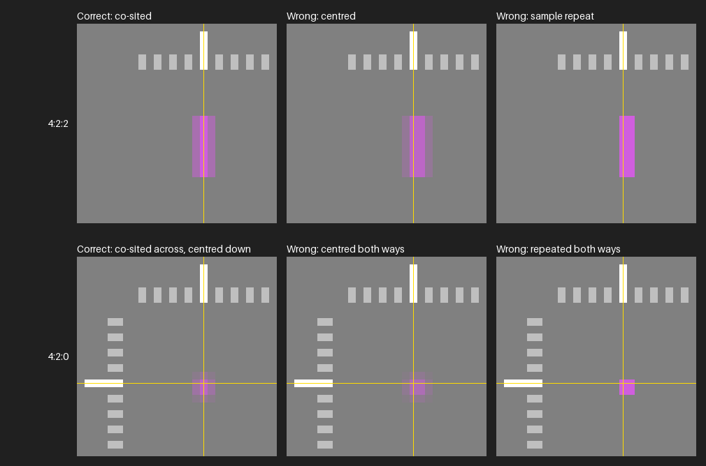

# Chroma Siting

<details open markdown="block">
  <summary>
    Table of contents
  </summary>
  {: .text-delta }
1. TOC
{:toc}
</details>

When an image is converted to 4:2:2 or 4:2:0, there is only one chroma (colour) sample for every two luma samples
across, and for 4:2:0 also for every two down. *Chroma siting* (or chroma sample location) is where each of
those chroma samples sits relative to the luma samples:

* **Co-sited**: the chroma sample sits on top of the even luma sample. This is what professional 4:2:2
  (SDI, ProRes, DNxHD/DNxHR) and H.264, HEVC and AV1 4:2:0 expect horizontally.
* **Centred**: the chroma sample sits half way between two luma samples. This is the JPEG/MPEG-1 convention.

Vertically, H.264/HEVC 4:2:0 puts the chroma half way between two rows, so the usual target for 4:2:0 is co-sited
horizontally and centred vertically. BT.2020 instead defines its 4:2:0 as co-sited in both directions, and
specifications disagree about which to use for UHD and HDR, and even for HD; see
[What specifications ask for](#what-specifications-ask-for).

**In FFmpeg, and in tools that follow it** (`zscale`, VapourSynth, mpv and others), these positions have names,
which this page uses too:

| FFmpeg name | Horizontally | Vertically (4:2:0 only) | Typical of |
| :--- | :--- | :--- | :--- |
| `left` | co-sited | centred | H.264/HEVC/AV1 4:2:0 (the default), MPEG-2 4:2:0 |
| `topleft` | co-sited | co-sited | BT.2020 4:2:0 |
| `center` | centred | centred | JPEG, MPEG-1 |

So in FFmpeg, co-sited is usually called `left`. For 4:2:2, which has a chroma sample on every row, `left` and
`topleft` are the same position. The names are FFmpeg's: the standards describe the positions in words or numbers
instead (see [Where this is specified](ChromaSitingTests.html#where-this-is-specified)). And "left" only describes the horizontal
position; that it also means vertically centred is FFmpeg's convention, taken from MPEG-2 and H.264.

If the converter puts the chroma in one place and the player assumes another, the colour is shifted half a pixel
against the detail. It is subtle, a fraction of a pixel on colour edges, but it is systematic, it accumulates
over round trips, and in most formats nothing in the file tells the player otherwise.

## Summary

* **`zscale` gets it right by default**, on every FFmpeg version we tested (6.0 to 9.1.dev): co-sited
  horizontally, centred vertically for 4:2:0.
* **`scale` (libswscale), and the conversion FFmpeg inserts when there is no filter, centre the chroma** on every
  version, including the new libswscale code (`flags=unstable`) and the current development build. 4:2:2 and
  H.264/HEVC/AV1 4:2:0 made this way are half a pixel off, and are read by players as co-sited.
* libswscale can be made to co-site, on 7.1 and later, with `out_chroma_loc=left` **and**
  `-sws_flags +full_chroma_inp`. Without `full_chroma_inp` it averages pairs of RGB pixels before filtering, and
  the result is only approximately co-sited.
* **In most delivery formats there is nowhere to record the siting**, so the conversion has to match what players
  assume: co-sited. Matroska is the exception.
* **Reading 4:2:2 or 4:2:0 back to RGB has the same problem in reverse.** `zscale` reads the file's chroma
  location and assumes co-sited when there is none. libswscale, which is what a plain `ffmpeg -i movie.mov
  frame.png` uses, assumes centred whatever the file says, up to and including 9.0, so stills from ProRes, DNxHR
  or H.264 come out with the colour half a pixel to the right. See [Reading back to RGB](#reading-back-to-rgb).
* **Players disagree too**, and a test chart shows which way each one goes when you look at it from a distance:
  of those we tried, only xStudio (with a fix) and Safari for HEVC/H.264 got 4:2:2 right throughout. For
  ordinary H.264/HEVC 4:2:0, Safari, Chrome and Firefox were right and OpenRV was not, and no player besides
  FFmpeg followed a chroma location tag reliably. See [Checking a player by eye](#checking-a-player).

Use `zscale` for the conversion, as in the recommended commands in [FFmpeg Version Changes](FFmpegChanges.html#recommended-commands)
and [zscale Conversion](EncodeZscale.html), and leave its chroma location at the default. The measurements for each
converter are in [Results by converter](ChromaSitingTests.html#results-by-converter).

## What it looks like

The test chart has single-pixel blue lines on a grey background. Converted to 4:2:2 and decoded again the way a
player would (assuming co-sited chroma), zoomed in. In each image, the columns are: the source, `zscale`,
`scale`, and `scale` with `out_chroma_loc=left` and `full_chroma_inp`. The bottom row is the difference from the
source, amplified 8 times.

Lines on **odd** columns:


With `zscale` (second column) the colour error is spread evenly either side of each line. With `scale` (third
column) it is all on the left: the line's colour has moved half a pixel. The top row shows how subtle that is
at normal viewing; the difference row shows that it is there.

Lines on **even** columns look the same for all three, which is why this is easy to miss:


## Where chroma siting is recorded

In most formats there is nowhere to say where the chroma is ([each codec and container](ChromaSitingTests.html#recorded-details)):

* **H.264, HEVC and AV1** have a field, for 4:2:0 only.
* **ProRes and DNxHD/DNxHR** have none, and MOV and MP4 add nothing to what the codec stream carries.
* **Matroska and WebM** record it for every codec, and FFmpeg reads it back.
* **MXF** records it, but FFmpeg does not read it back.

Two things follow:

* For ProRes and DNxHR in MOV, and for any 4:2:2 H.264 or HEVC, there is no way to say where the chroma is: it
  is always read as co-sited, so it has to be made co-sited.
* `ffprobe`'s `chroma_location` is not always what is in the file. For H.264 it shows `left` when nothing is
  written, even for 4:2:2, and for AV1 in MP4 it showed `unspecified` even when the stream had `left`.

**For 4:2:2 MXF, leave `zscale`'s chroma location at its default** (or use `topleft`), which gives the correct
`ColorSiting` of 0; do not set it to `left`. DNxHR in MXF made with `scale` is labelled co-sited while its chroma is
centred, so the file states the wrong thing; see [DNxHR in MXF](ChromaSitingTests.html#dnxhr-in-mxf).

## What specifications ask for {#what-specifications-ask-for}

For 4:2:2 there is no disagreement: it is co-sited. For 4:2:0 the choice is between `left` (H.264/HEVC VUI type
0, co-sited horizontally and centred vertically) and `topleft` (type 2, co-sited both ways), and the specifications
do not agree:

| Specification | 4:2:0 siting |
| :--- | :--- |
| ITU-T H.264 / H.265, Annex E | `left` (0) when nothing is signalled. H.265 has recommended `topleft` (2) for BT.2020 and BT.2100 video since its 2018 edition, according to [Dolby](https://ott.dolby.com/OnDelKits/Dolby_Vision_Online_Delivery_Kit/v1/Documentation/Specs/Visio_Profiles/help_files/topics/c_dovi_profiles_public.html) and 3GPP (we have not checked the ITU text) |
| [ITU-T H.Sup19](https://www.itu.int/epublications/publication/itu-t-h-suppl-19-2021-04-usage-of-video-signal-type-code-points) / ISO/IEC TR 23091-4, typical values | `left` (0) for SD and HD, `topleft` (2) for UHD with wide colour gamut |
| [DVB, ETSI TS 101 154](https://www.etsi.org/deliver/etsi_ts/101100_101199/101154/02.09.01_60/ts_101154v020901p.pdf) V2.9.1, clause 5.14.1.5.3 (HEVC) | The siting **shall** be signalled; recommends `left` (0) for progressive BT.709 and `topleft` (2) for progressive BT.2020. (For H.264 it recommends 0.) |
| [ATSC 3.0, A/341:2024](https://www.atsc.org/wp-content/uploads/2024/04/A341-2024-04-Video-HEVC.pdf), section 6.2.3.2 | **`topleft` (2), required for all progressive video**, including 1080p and 720p BT.709 SDR. `left` (0) for legacy SD and interlaced HD ([Amendment 1](https://www.atsc.org/wp-content/uploads/2022/09/A341-2022-03-Amendment-No-1.pdf), 2022) |
| [Dolby Vision profiles](https://ott.dolby.com/OnDelKits/Dolby_Vision_Online_Delivery_Kit/v1/Documentation/Specs/Visio_Profiles/help_files/topics/c_dovi_profiles_public.html) | Either, but the VUI must say so unless it is `left`. Default `left` (0) for profile 5 ("all commercially produced profile 5 ... bitstreams have used center-left siting"), for the HDR10 base layer of profile 8.1 and for the DVB HLG base layer of 8.4; `topleft` (2) for profile 7 (Ultra HD Blu-ray) and for the ARIB HLG base layer of 8.4 |

Where they disagree:

* **HD:** a 1080p BT.709 HEVC stream for ATSC 3.0 must be `topleft`; the same stream for DVB is recommended to be
  `left`, which is also what H.264/HEVC readers assume when nothing is signalled.
* **HDR10 and HLG:** H.265, DVB and ATSC point to `topleft` for BT.2020/BT.2100, but most streaming HDR (Dolby
  Vision profile 5, and the HDR10 base layer of profile 8.1) is `left`, and Dolby's own default for a DVB HLG base
  layer is `left` where DVB recommends `topleft`.
* **Players:** Dolby notes that `topleft` is checked when a Dolby Vision chip is approved, but not when a device
  is. A player that ignores the VUI treats `topleft` material as `left`, and puts the chroma half a line too
  low.

The default `zscale` siting (`left`) is right for H.264/HEVC 4:2:0 that does not say otherwise, and for DVB HD.
For a specification that asks for `topleft`, set it, and the encoder signals it: with `libx265`,
`zscale=matrix=709:range=limited:chromal=topleft` gave top-left chroma (measured 0.00 horizontally, 0.02
vertically) and VUI `chroma_sample_loc_type` 2 on FFmpeg 6.1.6 and 9.0.2. For a BT.2020 conversion use the
matching `matrix` and `primaries`. In 4:2:2 MXF, `topleft` is also the value that gives the correct `ColorSiting`
(see [DNxHR in MXF](ChromaSitingTests.html#dnxhr-in-mxf)).

## Reading back to RGB {#reading-back-to-rgb}

When FFmpeg converts 4:2:2 or 4:2:0 to RGB, for example to make review stills from a ProRes or H.264 file, it has
to decide where the chroma samples are before it can interpolate them. `zscale` reads the file's chroma location and
assumes co-sited when there is none, which is correct. libswscale (`scale`, or no filter) assumes centred whatever
the file says, on every release tested (6.1 to 9.0). The 9.1 development build follows the tag if there is one, and
still assumes centred if there is not ([measurements](ChromaSitingTests.html#reading-back-results)).

So a co-sited file, which is every ProRes, DNxHR and 4:2:2 H.264/HEVC file and most H.264/HEVC 4:2:0, converted
to RGB without a filter comes out half a pixel off on every released version. With 9.1 that will only be fixed
for files that carry a chroma location, which in MOV and MP4 is only 4:2:0 H.264/HEVC with a non-default
location (see [Where chroma siting is recorded](#where-chroma-siting-is-recorded)). Use `zscale`:

```console
ffmpeg -i input.mov -frames:v 1 -vf "zscale,format=gbrp16le" -pix_fmt rgb48be frame.png
```

`format=gbrp16le` keeps the conversion in `zscale` (it outputs planar RGB; the repack to `rgb48be` for PNG is
lossless). `zscale` needs the file's matrix to be tagged; for an untagged file give it with
`zscale=matrixin=709:rangein=limited`. The matrix and range accuracy of the conversion, and what happens with
untagged files, are covered in [FFmpeg Version Changes](FFmpegChanges.html#ycbcr-to-rgb).

## Checking a player by eye {#checking-a-player}

Most players and browsers cannot be measured from a script, so there are test charts you can look at instead. They are
in `sourceimages/`. How they work, and the results in detail, are on the separate [Chroma Siting Tests](ChromaSitingTests.html) page.

### Quick guide: what should I see? {#quick-guide}

There are two kinds of chart. The **player charts** are full HD: you look at them from a distance, and a whole band
changes appearance. The **pixel charts** are 64x64: you zoom in and look at single pixels. Start with a player chart;
use a pixel chart to confirm the result or to show someone exactly what is wrong.

| Chart | Open | Correct | Not correct |
| :--- | :--- | :--- | :--- |
| 4:2:2 player chart | `chroma_siting_player_chart_422-prores.mov` or `-hevc.mp4` | Only the top band, "Co-sited", is a flat field. The other three are still checkerboards | A different band is flat: the player assumes that instead. None flat: it is doing something else. The top band changes part way across: part of the picture is wrong (xStudio 1.4.0) |
| 4:2:0 player chart | `chroma_siting_player_chart_420-h264.mp4` or `-hevc.mp4` | Two bands are flat: "Across: co-sited" and "Down: centred". The other two are checkerboards | "Across: centred" is flat instead of "Across: co-sited": the colour is half a pixel to the right (OpenRV, xStudio 8-bit). "Down: co-sited" is flat instead of "Down: centred": the player assumes `topleft` |
| 4:2:2 pixel chart | `chroma_siting_pixel_chart_422-10bit.mkv` | One strong column of colour directly under each long tick, with a fainter column either side | The colour is off to the right of the tick: two strong columns starting at the tick (centred, or sample repeat) |
| 4:2:0 pixel chart | `chroma_siting_pixel_chart_420-10bit.mkv` | Across, as for 4:2:2. Down, two equally strong rows: the row of the long tick on the left and the row below it | The colour is off to the right of the top ruler's tick. Centred on the left ruler's tick row: the player assumes `topleft` |

The same pattern is correct for all the H.264, HEVC and AV1 files with no chroma location tag. The tagged 4:2:0 files
change the answer on purpose: `-topleft` should make "Across: co-sited" and "Down: co-sited" flat, and `-center` should
make "Across: centred" and "Down: centred" flat, if the player reads the tag ([details](ChromaSitingTests.html#chart-420)).

Three things catch people out:

* **Player charts only work at exactly 100%**, viewed from a distance. Their scale check patch, top right, should have
  two halves equally bright from a distance. If not, ignore the bands.
* **The colour of a flat band means nothing.** Each band has its own colours; only whether it is flat matters.
* **Pixel charts work at any zoom**, but in OpenRV stay on the default Linear filter. Flip against the matching
  `-reference.mkv` in the same player to compare, and judge where the colour is centred, not how blocky it looks.

Zoomed in on one cell of a pixel chart, with lines through the long ticks. In 4:2:0 the correct colour is centred on
the vertical line and straddles the row below the horizontal line:



A wrong result means fine colour detail sits half a pixel to the right of the luma, or is softer than it should be.
It is the player, not the file: these charts decode exactly in `zscale`.

### What we found

Measured on macOS 26 (Apple M2), at one image pixel per screen pixel. The [test page](ChromaSitingTests.html) has the
results per codec and FFmpeg version, and how the charts work.

| Player or conversion | 4:2:2,<br>should be co-sited ([BT.709 item 4.3](https://www.itu.int/rec/R-REC-BT.709)) | Ordinary H.264/HEVC 4:2:0,<br>should be `left`: co-sited across, centred down ([H.264](https://www.itu.int/rec/T-REC-H.264)/[H.265](https://www.itu.int/rec/T-REC-H.265) Annex E default) | Reads the chroma location tag? |
| :--- | :--- | :--- | :--- |
| `zscale` | Correct | Correct | Yes |
| libswscale, up to 9.0 | **Centred, or sample repeat** | **Centred both ways** | No |
| Safari 26.6.2 | Correct for HEVC and H.264; **ProRes wrong** | Correct | Partly |
| Chrome 156 | Correct for HEVC; **H.264 centred** | Correct, except **10-bit H.264 centred across** | Partly |
| Firefox 152 | **HEVC wrong**: chroma also lost vertically | Correct | No |
| OpenRV 3.1.0 | **Centred** | **Centred both ways** | No |
| xStudio, with the [4:2:2 fix](https://github.com/AcademySoftwareFoundation/xstudio/pull/361) (not yet merged) | 10-bit correct; **8-bit sample repeat** | 10-bit correct; **8-bit centred across** | No |

xStudio 1.4.0 has the same results as the fixed build, except that in 10-bit only the left half of the picture is
interpolated.
