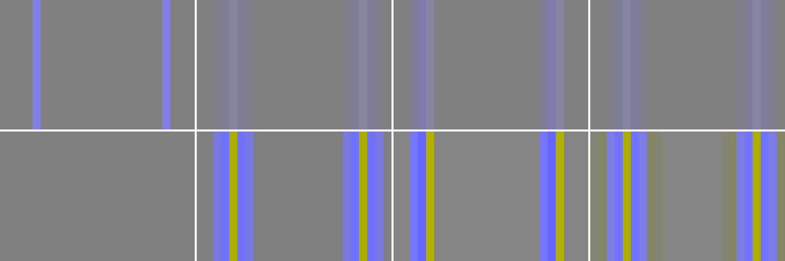
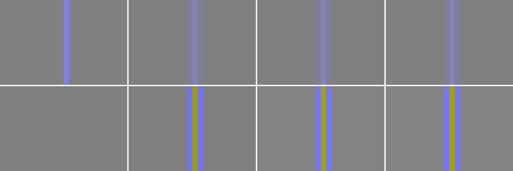
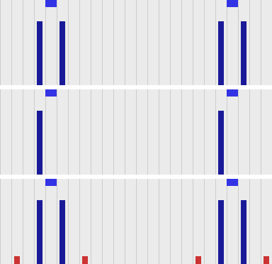

# Chroma Siting

<details open markdown="block">
  <summary>
    Table of contents
  </summary>
  {: .text-delta }
1. TOC
{:toc}
</details>

When an image is converted to 4:2:2 or 4:2:0, there is only one chroma (colour) sample for every two luma samples
across, and for 4:2:0 also for every two down. *Chroma siting* (or chroma sample location) is where each of
those chroma samples sits relative to the luma samples:

* **Co-sited** ("left"): the chroma sample sits on top of the even luma sample. This is what professional 4:2:2
  (SDI, ProRes, DNxHD/DNxHR) and H.264, HEVC and AV1 4:2:0 expect horizontally.
* **Centred** ("center"): the chroma sample sits half way between two luma samples. This is the JPEG/MPEG-1
  convention.

Vertically, H.264/HEVC 4:2:0 ("left") puts the chroma half way between two rows, so the usual target for 4:2:0
is co-sited horizontally and centred vertically. BT.2020 instead defines its 4:2:0 as co-sited in both directions
("top-left"), which is why some UHD/HDR delivery specifications ask for that; check yours.

If the converter puts the chroma in one place and the player assumes another, the colour is shifted half a pixel
against the detail. It is subtle, a fraction of a pixel on colour edges, but it is systematic, it accumulates
over round trips, and in most formats nothing in the file tells the player otherwise.

## Summary

* **`zscale` gets it right by default**, on every FFmpeg version we tested (6.0 to 9.1.dev): co-sited
  horizontally, centred vertically for 4:2:0.
* **`scale` (libswscale), and the conversion FFmpeg inserts when there is no filter, centre the chroma** on every
  version, including the new libswscale code (`flags=unstable`) and the current development build. 4:2:2 and
  H.264/HEVC/AV1 4:2:0 made this way are half a pixel off, and are read by players as co-sited.
* libswscale can be made to co-site, on 7.1 and later, with `out_chroma_loc=left` **and**
  `-sws_flags +full_chroma_inp`. Without `full_chroma_inp` it averages pairs of RGB pixels before filtering, and
  the result is only approximately co-sited.
* **In most delivery formats there is nowhere to record the siting**, so the conversion has to match what players
  assume: co-sited. Matroska is the exception.

Use `zscale` for the conversion, as in the recommended commands in [FFmpeg Version Changes](FFmpegChanges.html#recommended-commands)
and [zscale Conversion](EncodeZscale.html), and leave its chroma location at the default.

## What it looks like

The test chart has single-pixel blue lines on a grey background. Converted to 4:2:2 and decoded again the way a
player would (assuming co-sited chroma), zoomed in. In each image, the columns are: the source, `zscale`,
`scale`, and `scale` with `out_chroma_loc=left` and `full_chroma_inp`. The bottom row is the difference from the
source, amplified 8 times.

Lines on **odd** columns:



With `zscale` (second column) the colour error is spread evenly either side of each line. With `scale` (third
column) it is all on the left: the line's colour has moved half a pixel. The top row shows how subtle that is
at normal viewing; the difference row shows that it is there.

Lines on **even** columns look the same for all three, which is why this is easy to miss:



### Where the chroma samples went

Each bar is one chroma (Cb) sample, drawn where a co-sited format says it is, under the blue marker for the
source line. Rows: `zscale`, `scale`, `scale` with `out_chroma_loc=left` and `full_chroma_inp`.



For a line on an odd column, which falls between two co-sited chroma samples, `zscale` and the corrected `scale`
put equal amounts in the samples either side. Plain `scale` puts it all in the sample to the left: it has
averaged the line with its neighbour into a single, centred value. The small red bars on the bottom row are
the bicubic filter's ringing.

## Results by converter

Converting RGB to 4:2:2 and 4:2:0. Positions are in luma samples: 0 is co-sited, 0.5 is centred. The results
were the same on 6.0, 7.0, 7.1, 8.0.1, 8.1, 9.0 and a 9.1 development build, except where noted.

| Converter | 4:2:2 | 4:2:0 (horizontal / vertical) | Correct? |
| :--- | :--- | :--- | :--- |
| `zscale` (default) | co-sited | co-sited / centred | Yes |
| `zscale=...:chromal=center` | centred | centred / centred | Only for formats that want centred chroma |
| `scale`, or no filter | centred, pair-averaged | centred / centred | **No** |
| `scale=...:flags=unstable` (8.1+) | centred, pair-averaged | centred / centred | **No**, the same as `scale` |
| `scale=...:out_chroma_loc=left` (7.1+) or `out_h_chr_pos=0` | -0.05, pair-averaged | -0.05 / centred | Close, not exact |
| as above, plus `-sws_flags +full_chroma_inp` | co-sited | co-sited / centred | Yes |
| no filter, `-chroma_sample_location left` | centred; **co-sited (-0.05) in 9.1.dev** | the same | Not in any release yet |

"Pair-averaged" means the converter averaged each pair of RGB pixels into one chroma value before filtering:
a line on an even column and a line on the following odd column give exactly the same chroma. libswscale does
this for RGB input unless `full_chroma_inp` is set, whatever position it is asked for, which is why asking for
co-sited without that flag only gets to within 0.05 of a pixel. Note that this contradicts older advice
(including earlier versions of [Ffmpeg Scaling Options](EncodeSwsScale.html)) that `full_chroma_inp` does nothing
for RGB input.

The last row is a change that is coming: in FFmpeg development builds after 9.0, `-chroma_sample_location` is
passed into the filter graph, the way 7.1 started doing for `-colorspace`, so the conversion FFmpeg inserts
follows it. In 9.0 and earlier it does not affect the conversion.

## Where chroma siting is recorded

What FFmpeg 9.0 writes, for frames that carry a chroma location:

| Codec | Field | 4:2:0 | 4:2:2 |
| :--- | :--- | :--- | :--- |
| H.264 | VUI `chroma_sample_loc_type` (4:2:0 only) | Written, except `left` (the default, which readers assume when nothing is written) | No field; assumed co-sited |
| HEVC (`libx265`) | VUI, as H.264 (4:2:0 only) | Written | No field |
| AV1 (`libsvtav1`) | `chroma_sample_position` (4:2:0 only) | `left` and `topleft` written; AV1 has no value for centred | No field |
| AV1 (`libaom-av1`) | as above | Always written as unknown: FFmpeg's `libaom` wrapper does not pass it on | No field |
| VP9 | None (not tested: no `libvpx` in our builds) | | |
| ProRes, DNxHD/DNxHR | None | | Assumed co-sited |

| Container | Field | Behaviour |
| :--- | :--- | :--- |
| Matroska / WebM | `ChromaSitingHorz`, `ChromaSitingVert` | Written for every codec and subsampling, and read back by FFmpeg. The only container here that records siting for every codec and FFmpeg reads back. |
| MXF | `ColorSiting` | Written, but not read back by FFmpeg. With no location on the frames, 4:2:2 is written as 0 (co-sited). FFmpeg maps `left` to 6 and `center` to 3 whatever the subsampling, which are ST 377-1's 4:2:0 values; for 4:2:2 the matching values would be 0 and 1. |
| MOV / MP4 | None | Only what the codec stream itself carries. |

Two things follow:

* For ProRes and DNxHR in MOV, and for any 4:2:2 H.264 or HEVC, there is no way to say where the chroma is: it
  is always read as co-sited, so it has to be made co-sited.
* `ffprobe`'s `chroma_location` is not always what is in the file. For H.264 it shows `left` when nothing is
  written, even for 4:2:2, and for AV1 in MP4 it showed `unspecified` even when the stream had `left`.

### DNxHR in MXF

MXF does record siting, which makes a mismatch worse rather than better: the file states the wrong thing.
Encoding the test chart to DNxHR HQX 4:2:2 in MXF (OP1a and OP-Atom gave the same results; also the same on 6.0,
7.1 and 9.0):

| Command | MXF `ColorSiting` | Chroma actually is |
| :--- | :--- | :--- |
| `scale=in_range=full:in_color_matrix=bt709:out_range=tv:out_color_matrix=bt709` | 0, co-sited | **centred**: the label is wrong |
| `zscale=rangein=full:matrix=709:range=limited` | 0, co-sited | co-sited |
| `zscale=...:chromal=left` | 6, vertical midpoint | co-sited, but the label is odd for 4:2:2 |
| `scale` with `out_chroma_loc=left` and `full_chroma_inp` | 6, vertical midpoint | co-sited |

FFmpeg names 4:2:2 co-siting `topleft`, and maps `left` to MXF value 6, "vertical midpoint", which ST 377-1
defines as the MPEG-2 and H.264 4:2:0 position. For 4:2:2 that is the wrong value: a reader that takes it
literally sees 4:2:0 siting on 4:2:2 material. So for 4:2:2 MXF, leave `zscale`'s chroma location at its default
(or use `topleft`), which gives 0; do not set it to `left`.

## How this was tested

* `sourceimages/chroma_siting_chart.png`, generated by `sourceimages/make_chroma_siting_chart.py` and described
  in `sourceimages/README.md`, has linear "tents" in blue that peak exactly between two columns (rows), and
  single-pixel lines on even and odd columns (rows).
* The chroma position is where the two sides of the tent meet in the converted chroma plane: a symmetric filter
  on a linear ramp returns the ramp's value at the filter's centre, so this gives the sample position
  independently of the filter, gain or offset. The lines give the same position a second way, and show whether
  even and odd columns are treated alike.
* All conversions are to 16-bit 4:2:2 and 4:2:0 written as raw video, so no codec is involved, except the
  tagging and DNxHR tests, which encode with each codec.

```console
rez-env encodingguidelines_env -- python tests/chroma_siting.py --rez 6.0 7.0 7.1 8.0.1 8.1 9.0 9.1.dev
rez-env encodingguidelines_env ffmpeg-9.0 -- python tests/chroma_siting_containers.py
rez-env encodingguidelines_env ffmpeg-9.0 -- python tests/chroma_siting_images.py
```

Not yet covered: the reverse direction. What FFmpeg assumes when reading 4:2:2 or 4:2:0 back to RGB, for example
making review stills from a ProRes, has not been tested yet.

## Where this is specified

| Specification | What it says |
| :--- | :--- |
| [ITU-R BT.601-7](https://www.itu.int/rec/R-REC-BT.601) (SD), Part A, sampling structure | "C<sub>R</sub> and C<sub>B</sub> samples co-sited with odd (1st, 3rd, 5th, etc.) Y samples in each line" |
| [ITU-R BT.709-6](https://www.itu.int/rec/R-REC-BT.709) (HD), item 4.3 | C<sub>B</sub>, C<sub>R</sub> "co-sited with each other and with alternate Y samples", "the first active colour-difference samples being co-sited with the first active luminance sample" |
| [ITU-R BT.2020-2](https://www.itu.int/rec/R-REC-BT.2020) (UHD), Table 5 | For 4:2:2 and 4:2:0: "The first (top-left) sample is co-sited with the first Y' samples" |
| [ITU-T H.264](https://www.itu.int/rec/T-REC-H.264) and [ITU-T H.265](https://www.itu.int/rec/T-REC-H.265), Annex E (VUI) | `chroma_sample_loc_type_top_field` / `_bottom_field`, values 0 to 5, for 4:2:0 only, shown in Figure E-1. 0 (left: co-sited horizontally, centred vertically) is the default when nothing is signalled. |
| [ITU-T H.273](https://www.itu.int/rec/T-REC-H.273) (07/21 and later) | Adds a coding-independent code point for the 4:2:0 chroma sampling grid alignment, alongside the familiar primaries, transfer and matrix code points |
| [AV1 specification](https://aomediacodec.github.io/av1-spec/#color-config-semantics), colour config semantics | `chroma_sample_position`, 4:2:0 only: 0 unknown, 1 `CSP_VERTICAL` "horizontally co-located with (0, 0) luma sample, vertical position in the middle between two luma samples", 2 `CSP_COLOCATED` "co-located with (0, 0) luma sample". There is no value for centred. |
| [Matroska, RFC 9559](https://www.rfc-editor.org/rfc/rfc9559#section-5.1.4.1.28.23) sections 5.1.4.1.28.23 and .24 | `ChromaSitingHorz`: 0 unspecified, 1 left collocated, 2 half. `ChromaSitingVert`: 0 unspecified, 1 top collocated, 2 half. |
| SMPTE ST 377-1:2019 (MXF), section G.2.29, CDCI picture descriptor | `ColorSiting`: 0 coSiting, "as in ITU-R Rec 601, SMPTE ST 314 4:1:1 or MPEG-2 4:2:2"; 1 horizontal mid-point; 3 quincunx, "as in MPEG-1 4:2:0"; 4 Rec601 (equivalent to 0, deprecated); 5 line alternating; 6 vertical midpoint, "as in MPEG-2 4:2:0 and H.264/AVC 4:2:0"; 255 unknown, the default when absent. (SMPTE standards are not freely available.) |
| FFmpeg [`AVChromaLocation`](https://github.com/FFmpeg/FFmpeg/blob/master/libavutil/pixfmt.h) (`libavutil/pixfmt.h`) | FFmpeg's own names, with a diagram: `left` is "MPEG-2/4 4:2:0, H.264 default for 4:2:0", `center` is "MPEG-1 4:2:0, JPEG 4:2:0", `topleft` is "ITU-R 601, SMPTE 274M ..., mpeg2 4:2:2" |

So in FFmpeg's terms, professional 4:2:2 is `topleft` (for 4:2:2, which has no vertical subsampling, `left` and
`topleft` put the chroma in the same place), H.264/HEVC 4:2:0 is `left`, and BT.2020 4:2:0 is `topleft`.
