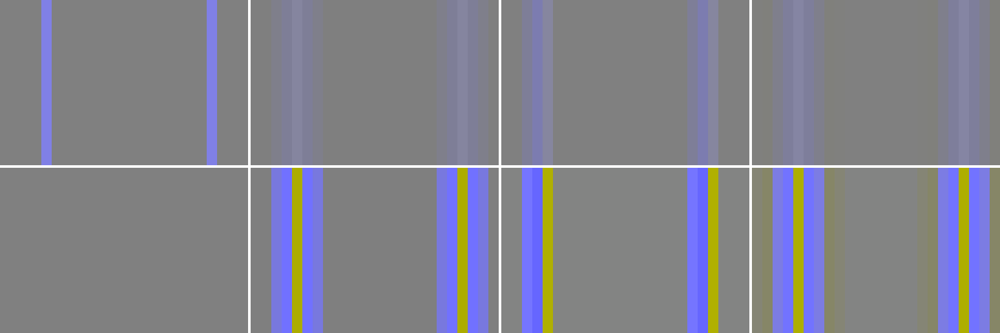
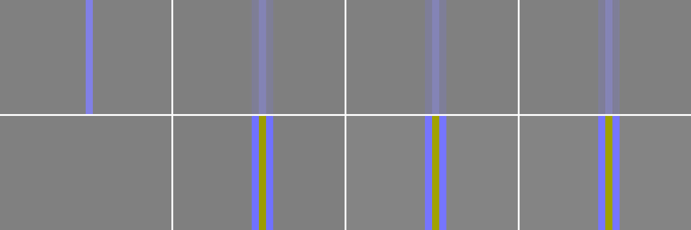
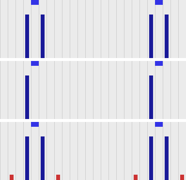
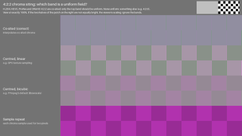
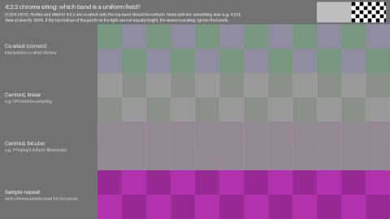
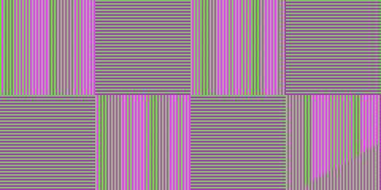
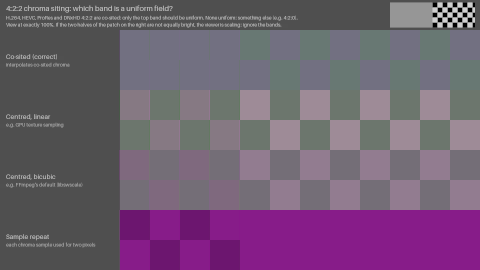
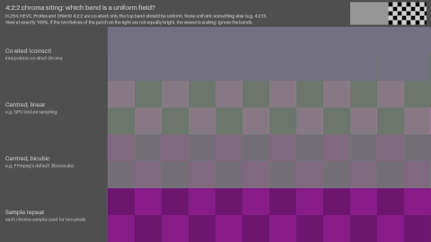

# Chroma Siting

<details open markdown="block">
  <summary>
    Table of contents
  </summary>
  {: .text-delta }
1. TOC
{:toc}
</details>

When an image is converted to 4:2:2 or 4:2:0, there is only one chroma (colour) sample for every two luma samples
across, and for 4:2:0 also for every two down. *Chroma siting* (or chroma sample location) is where each of
those chroma samples sits relative to the luma samples:

* **Co-sited**: the chroma sample sits on top of the even luma sample. This is what professional 4:2:2
  (SDI, ProRes, DNxHD/DNxHR) and H.264, HEVC and AV1 4:2:0 expect horizontally.
* **Centred**: the chroma sample sits half way between two luma samples. This is the JPEG/MPEG-1 convention.

Vertically, H.264/HEVC 4:2:0 puts the chroma half way between two rows, so the usual target for 4:2:0 is co-sited
horizontally and centred vertically. BT.2020 instead defines its 4:2:0 as co-sited in both directions, and
specifications disagree about which to use for UHD and HDR, and even for HD; see
[What specifications ask for](#what-specifications-ask-for).

**In FFmpeg, and in tools that follow it** (`zscale`, VapourSynth, mpv and others), these positions have names,
which this page uses too:

| FFmpeg name | Horizontally | Vertically (4:2:0 only) | Typical of |
| :--- | :--- | :--- | :--- |
| `left` | co-sited | centred | H.264/HEVC/AV1 4:2:0 (the default), MPEG-2 4:2:0 |
| `topleft` | co-sited | co-sited | BT.2020 4:2:0 |
| `center` | centred | centred | JPEG, MPEG-1 |

So in FFmpeg, co-sited is usually called `left`. For 4:2:2, which has a chroma sample on every row, `left` and
`topleft` are the same position. The names are FFmpeg's: the standards describe the positions in words or numbers
instead (see [Where this is specified](#where-this-is-specified)). And "left" only describes the horizontal
position; that it also means vertically centred is FFmpeg's convention, taken from MPEG-2 and H.264.

If the converter puts the chroma in one place and the player assumes another, the colour is shifted half a pixel
against the detail. It is subtle, a fraction of a pixel on colour edges, but it is systematic, it accumulates
over round trips, and in most formats nothing in the file tells the player otherwise.

## Summary

* **`zscale` gets it right by default**, on every FFmpeg version we tested (6.0 to 9.1.dev): co-sited
  horizontally, centred vertically for 4:2:0.
* **`scale` (libswscale), and the conversion FFmpeg inserts when there is no filter, centre the chroma** on every
  version, including the new libswscale code (`flags=unstable`) and the current development build. 4:2:2 and
  H.264/HEVC/AV1 4:2:0 made this way are half a pixel off, and are read by players as co-sited.
* libswscale can be made to co-site, on 7.1 and later, with `out_chroma_loc=left` **and**
  `-sws_flags +full_chroma_inp`. Without `full_chroma_inp` it averages pairs of RGB pixels before filtering, and
  the result is only approximately co-sited.
* **In most delivery formats there is nowhere to record the siting**, so the conversion has to match what players
  assume: co-sited. Matroska is the exception.
* **Reading 4:2:2 or 4:2:0 back to RGB has the same problem in reverse.** `zscale` reads the file's chroma
  location and assumes co-sited when there is none. libswscale, which is what a plain `ffmpeg -i movie.mov
  frame.png` uses, assumes centred whatever the file says, up to and including 9.0, so stills from ProRes, DNxHR
  or H.264 come out with the colour half a pixel to the right. See [Reading back to RGB](#reading-back-to-rgb).
* **Players disagree too**, and a test chart shows which way each one goes when you look at it from a distance:
  of those we tried, only xStudio (with a fix) and Safari for HEVC/H.264 got 4:2:2 right throughout. See
  [Checking a player by eye](#checking-a-player).

Use `zscale` for the conversion, as in the recommended commands in [FFmpeg Version Changes](FFmpegChanges.html#recommended-commands)
and [zscale Conversion](EncodeZscale.html), and leave its chroma location at the default.

## What it looks like

The test chart has single-pixel blue lines on a grey background. Converted to 4:2:2 and decoded again the way a
player would (assuming co-sited chroma), zoomed in. In each image, the columns are: the source, `zscale`,
`scale`, and `scale` with `out_chroma_loc=left` and `full_chroma_inp`. The bottom row is the difference from the
source, amplified 8 times.

Lines on **odd** columns:



With `zscale` (second column) the colour error is spread evenly either side of each line. With `scale` (third
column) it is all on the left: the line's colour has moved half a pixel. The top row shows how subtle that is
at normal viewing; the difference row shows that it is there.

Lines on **even** columns look the same for all three, which is why this is easy to miss:



### Where the chroma samples went

Each bar is one chroma (Cb) sample, drawn where a co-sited format says it is, under the blue marker for the
source line. Rows: `zscale`, `scale`, `scale` with `out_chroma_loc=left` and `full_chroma_inp`.



For a line on an odd column, which falls between two co-sited chroma samples, `zscale` and the corrected `scale`
put equal amounts in the samples either side. Plain `scale` puts it all in the sample to the left: it has
averaged the line with its neighbour into a single, centred value. The small red bars on the bottom row are
the bicubic filter's ringing.

## Results by converter

Converting RGB to 4:2:2 and 4:2:0. Positions are in luma samples: 0 is co-sited, 0.5 is centred. The results
were the same on 6.0, 7.0, 7.1, 8.0.1, 8.1, 9.0 and a 9.1 development build, except where noted.

| Converter | 4:2:2 | 4:2:0 (horizontal / vertical) | Correct? |
| :--- | :--- | :--- | :--- |
| `zscale` (default) | co-sited | co-sited / centred | Yes |
| `zscale=...:chromal=center` | centred | centred / centred | Only for formats that want centred chroma |
| `scale`, or no filter | centred, pair-averaged | centred / centred | **No** |
| `scale=...:flags=unstable` (8.1+) | centred, pair-averaged | centred / centred | **No**, the same as `scale` |
| `scale=...:out_chroma_loc=left` (7.1+) or `out_h_chr_pos=0` | -0.05, pair-averaged | -0.05 / centred | Close, not exact |
| as above, plus `-sws_flags +full_chroma_inp` | co-sited | co-sited / centred | Yes |
| no filter, `-chroma_sample_location left` | centred; **co-sited (-0.05) in 9.1.dev** | the same | Not in any release yet |

"Pair-averaged" means the converter averaged each pair of RGB pixels into one chroma value before filtering:
a line on an even column and a line on the following odd column give exactly the same chroma. libswscale does
this for RGB input unless `full_chroma_inp` is set, whatever position it is asked for, which is why asking for
co-sited without that flag only gets to within 0.05 of a pixel. Note that this contradicts older advice
(including earlier versions of [Ffmpeg Scaling Options](EncodeSwsScale.html)) that `full_chroma_inp` does nothing
for RGB input.

The last row is a change that is coming: in FFmpeg development builds after 9.0, `-chroma_sample_location` is
passed into the filter graph, the way 7.1 started doing for `-colorspace`, so the conversion FFmpeg inserts
follows it. In 9.0 and earlier it does not affect the conversion.

## Where chroma siting is recorded

What FFmpeg 9.0 writes, for frames that carry a chroma location:

| Codec | Field | 4:2:0 | 4:2:2 |
| :--- | :--- | :--- | :--- |
| H.264 | VUI `chroma_sample_loc_type` (4:2:0 only) | Written, except `left` (the default, which readers assume when nothing is written) | No field; assumed co-sited |
| HEVC (`libx265`) | VUI, as H.264 (4:2:0 only) | Written | No field |
| AV1 (`libsvtav1`) | `chroma_sample_position` (4:2:0 only) | `left` and `topleft` written; AV1 has no value for centred | No field |
| AV1 (`libaom-av1`) | as above | Always written as unknown: FFmpeg's `libaom` wrapper does not pass it on | No field |
| VP9 | None (not tested: no `libvpx` in our builds) | | |
| ProRes, DNxHD/DNxHR | None | | Assumed co-sited |

| Container | Field | Behaviour |
| :--- | :--- | :--- |
| Matroska / WebM | `ChromaSitingHorz`, `ChromaSitingVert` | Written for every codec and subsampling, and read back by FFmpeg. The only container here that records siting for every codec and FFmpeg reads back. |
| MXF | `ColorSiting` | Written, but not read back by FFmpeg. With no location on the frames, 4:2:2 is written as 0 (co-sited). FFmpeg maps `left` to 6 and `center` to 3 whatever the subsampling, which are ST 377-1's 4:2:0 values; for 4:2:2 the matching values would be 0 and 1. |
| MOV / MP4 | None | Only what the codec stream itself carries. |

Two things follow:

* For ProRes and DNxHR in MOV, and for any 4:2:2 H.264 or HEVC, there is no way to say where the chroma is: it
  is always read as co-sited, so it has to be made co-sited.
* `ffprobe`'s `chroma_location` is not always what is in the file. For H.264 it shows `left` when nothing is
  written, even for 4:2:2, and for AV1 in MP4 it showed `unspecified` even when the stream had `left`.

### DNxHR in MXF

MXF does record siting, which makes a mismatch worse rather than better: the file states the wrong thing.
Encoding the test chart to DNxHR HQX 4:2:2 in MXF (OP1a and OP-Atom gave the same results; also the same on 6.0,
7.1 and 9.0):

| Command | MXF `ColorSiting` | Chroma actually is |
| :--- | :--- | :--- |
| `scale=in_range=full:in_color_matrix=bt709:out_range=tv:out_color_matrix=bt709` | 0, co-sited | **centred**: the label is wrong |
| `zscale=rangein=full:matrix=709:range=limited` | 0, co-sited | co-sited |
| `zscale=...:chromal=left` | 6, vertical midpoint | co-sited, but the label is odd for 4:2:2 |
| `scale` with `out_chroma_loc=left` and `full_chroma_inp` | 6, vertical midpoint | co-sited |

FFmpeg names 4:2:2 co-siting `topleft`, and maps `left` to MXF value 6, "vertical midpoint", which ST 377-1
defines as the MPEG-2 and H.264 4:2:0 position. For 4:2:2 that is the wrong value: a reader that takes it
literally sees 4:2:0 siting on 4:2:2 material. So for 4:2:2 MXF, leave `zscale`'s chroma location at its default
(or use `topleft`), which gives 0; do not set it to `left`.

## What specifications ask for {#what-specifications-ask-for}

For 4:2:2 there is no disagreement: it is co-sited. For 4:2:0 the choice is between `left` (H.264/HEVC VUI type
0, co-sited horizontally and centred vertically) and `topleft` (type 2, co-sited both ways), and the specifications
do not agree:

| Specification | 4:2:0 siting |
| :--- | :--- |
| ITU-T H.264 / H.265, Annex E | `left` (0) when nothing is signalled. H.265 has recommended `topleft` (2) for BT.2020 and BT.2100 video since its 2018 edition, according to [Dolby](https://ott.dolby.com/OnDelKits/Dolby_Vision_Online_Delivery_Kit/v1/Documentation/Specs/Visio_Profiles/help_files/topics/c_dovi_profiles_public.html) and 3GPP (we have not checked the ITU text) |
| [ITU-T H.Sup19](https://www.itu.int/epublications/publication/itu-t-h-suppl-19-2021-04-usage-of-video-signal-type-code-points) / ISO/IEC TR 23091-4, typical values | `left` (0) for SD and HD, `topleft` (2) for UHD with wide colour gamut |
| [DVB, ETSI TS 101 154](https://www.etsi.org/deliver/etsi_ts/101100_101199/101154/02.09.01_60/ts_101154v020901p.pdf) V2.9.1, clause 5.14.1.5.3 (HEVC) | The siting **shall** be signalled; recommends `left` (0) for progressive BT.709 and `topleft` (2) for progressive BT.2020. (For H.264 it recommends 0.) |
| [ATSC 3.0, A/341:2024](https://www.atsc.org/wp-content/uploads/2024/04/A341-2024-04-Video-HEVC.pdf), section 6.2.3.2 | **`topleft` (2), required for all progressive video**, including 1080p and 720p BT.709 SDR. `left` (0) for legacy SD and interlaced HD ([Amendment 1](https://www.atsc.org/wp-content/uploads/2022/09/A341-2022-03-Amendment-No-1.pdf), 2022) |
| [Dolby Vision profiles](https://ott.dolby.com/OnDelKits/Dolby_Vision_Online_Delivery_Kit/v1/Documentation/Specs/Visio_Profiles/help_files/topics/c_dovi_profiles_public.html) | Either, but the VUI must say so unless it is `left`. Default `left` (0) for profile 5 ("all commercially produced profile 5 ... bitstreams have used center-left siting"), for the HDR10 base layer of profile 8.1 and for the DVB HLG base layer of 8.4; `topleft` (2) for profile 7 (Ultra HD Blu-ray) and for the ARIB HLG base layer of 8.4 |

Where they disagree:

* **HD:** a 1080p BT.709 HEVC stream for ATSC 3.0 must be `topleft`; the same stream for DVB is recommended to be
  `left`, which is also what H.264/HEVC readers assume when nothing is signalled.
* **HDR10 and HLG:** H.265, DVB and ATSC point to `topleft` for BT.2020/BT.2100, but most streaming HDR (Dolby
  Vision profile 5, and the HDR10 base layer of profile 8.1) is `left`, and Dolby's own default for a DVB HLG base
  layer is `left` where DVB recommends `topleft`.
* **Players:** Dolby notes that `topleft` is checked when a Dolby Vision chip is approved, but not when a device
  is. A player that ignores the VUI treats `topleft` material as `left`, and puts the chroma half a line too
  low.

The default `zscale` siting (`left`) is right for H.264/HEVC 4:2:0 that does not say otherwise, and for DVB HD.
For a specification that asks for `topleft`, set it, and the encoder signals it: with `libx265`,
`zscale=matrix=709:range=limited:chromal=topleft` gave top-left chroma (measured 0.00 horizontally, 0.02
vertically) and VUI `chroma_sample_loc_type` 2 on FFmpeg 6.1.6 and 9.0.2. For a BT.2020 conversion use the
matching `matrix` and `primaries`. In 4:2:2 MXF, `topleft` is also the value that gives the correct `ColorSiting`
(see [DNxHR in MXF](#dnxhr-in-mxf)).

## Reading back to RGB {#reading-back-to-rgb}

When FFmpeg converts 4:2:2 or 4:2:0 to RGB, for example to make review stills from a ProRes or H.264 file, it has
to decide where the chroma samples are before it can interpolate them. Measured by decoding 4:2:2 and 4:2:0
versions of the test chart with known siting to 16-bit RGB PNG, with and without a chroma location tag (FFV1 in
Matroska, which carries the tag through to FFmpeg's decoder). Positions are in luma samples: 0 is co-sited, 0.5
centred.

| Converter | Tagged `left` or `topleft` | Tagged `center` | No tag (chroma co-sited) |
| :--- | :--- | :--- | :--- |
| `zscale` | Correct | Correct | Assumes co-sited: correct |
| `scale`, or no filter, 6.1 to 9.0 | **Assumes centred: chroma 0.5 to the right** | Correct | **Assumes centred: 0.5 to the right** |
| `scale`, or no filter, 9.1.dev | Follows the tag (within 0.07) | Correct | **Assumes centred: 0.5 to the right** |

The results were the same on 6.1.6, 7.0, 7.1.5, 8.0.1, 8.1 and 9.0.2; the 9.1 development build (N-127508) is
the only one that differs, and only for coarse detail when converting to packed RGB such as PNG: the finest
chroma detail still comes out as if centred (see [How it works](#how-it-works)). `-sws_flags +full_chroma_int` (or `scale=flags=...+full_chroma_int`) makes libswscale
interpolate the chroma instead of repeating each sample across two pixels, which it otherwise does when converting
4:2:x to RGB, but it does not change the position it assumes.

So a co-sited file, which is every ProRes, DNxHR and 4:2:2 H.264/HEVC file and most H.264/HEVC 4:2:0, converted
to RGB without a filter comes out half a pixel off on every released version. With 9.1 that will only be fixed
for files that carry a chroma location, which in MOV and MP4 is only 4:2:0 H.264/HEVC with a non-default
location (see [Where chroma siting is recorded](#where-chroma-siting-is-recorded)). Use `zscale`:

```console
ffmpeg -i input.mov -frames:v 1 -vf "zscale,format=gbrp16le" -pix_fmt rgb48be frame.png
```

`format=gbrp16le` keeps the conversion in `zscale` (it outputs planar RGB; the repack to `rgb48be` for PNG is
lossless). `zscale` needs the file's matrix to be tagged; for an untagged file give it with
`zscale=matrixin=709:rangein=limited`. The matrix and range accuracy of the conversion, and what happens with
untagged files, are covered in [FFmpeg Version Changes](FFmpegChanges.html#ycbcr-to-rgb).

## Checking a player by eye {#checking-a-player}

Players and browsers make the same choice when they display 4:2:2, and most of them cannot be measured from a
script. For those there is a chart you look at instead: `sourceimages/chroma_siting_player_chart_422-prores.mov`
(ProRes 422 HQ), `-hevc.mp4` (HEVC 4:2:2 10-bit, which browsers play), `-h264.mp4` (lossless H.264 4:2:2
10-bit) and `-dnxhr.mxf` (DNxHR HQX), with a lossless FFV1 copy in `chroma_siting_player_chart_422.mkv`, and two
deliberately mislabelled files (see [Does the player read the label?](#reading-the-label)). They are made by
`sourceimages/make_chroma_siting_player_chart.py`. The chroma in every file is co-sited, and the encodes keep the
pattern intact (`zscale` decodes all of them exactly), so a wrong band is the player, not the file. Do not
re-encode them: heavier compression blurs the one-pixel stripes.

### Reading the chart

1. **Show it at exactly 100%**: one image pixel per screen pixel ("1:1" in RV and xStudio, not "fit"; in a
   browser, page zoom 100% and a window wide enough for the whole frame). The patch at the top right is the
   check: from a distance its two halves should look equally bright. If the fine half looks darker, the player is
   scaling the picture, and the bands mean nothing.
2. **Step back**, or look at it from across the room. Each band is a checkerboard of striped blocks. The band
   that turns into a uniform field says how the player rebuilds the chroma. For a correct player that is the top
   one: H.264, HEVC, ProRes and DNxHD/DNxHR 4:2:2 are all co-sited.

| Band | Uniform when the player | Typical of |
| :--- | :--- | :--- |
| Co-sited (correct) | treats the chroma as co-sited and interpolates it | `zscale`; xStudio with the fix below |
| Centred, linear | treats it as centred, linear interpolation | GPU texture sampling (RV); libswscale `bilinear` |
| Centred, bicubic | treats it as centred, bicubic or lanczos | libswscale to planar RGB, or with `full_chroma_int` |
| Sample repeat | uses each chroma sample for two pixels | libswscale to packed RGB (e.g. writing a PNG), up to 9.0 |

If no band is uniform, the player is doing something else, for example converting to 4:2:0 or using the nearest
chroma sample. Look closer for stripes that should not be there (see Safari below).

What the chart looks like from a distance (simulated by averaging in linear light), decoded by `zscale` (left)
and by libswscale to planar RGB on 9.0 (right):

| `zscale`: top band uniform | libswscale, centred bicubic: third band uniform |
| :--- | :--- |
|  |  |

These are pictures of the result, already converted to RGB, so they look the same in any viewer. The test is the
video files.

### How it works

The test blocks have vertical stripes in a four-pixel cycle, with the two chroma samples on the even (co-sited)
columns. 4:2:2 keeps those and drops the odd columns, so the player has to rebuild the odd columns' chroma, and
how it does that depends on where it thinks the samples are. The reference blocks have the same stripes turned
through 90 degrees, which 4:2:2 holds exactly, since it has full vertical chroma resolution. Each band's
reference stripes are set to the pixels one kind of player makes from its test stripes. In the band that matches
the player, test and reference blocks then contain exactly the same pixels, so they match whatever the display,
its gamma, or a view transform such as ACES does to them.

The difference between the blocks only appears when the display turns each pixel into light and the eye averages
it. Y'CbCr to R'G'B' is linear, so the average code value of a test block is the same for every player. A viewer
that shrinks the picture averages code values before the display does, which removes the difference. At half
size or less a wrong player then looks right, hence the scale check, which is also pure black and white for the
same reason. The colours were chosen so that each wrong band differs from the right one by at least 0.04 in Oklab
(linear-light means, gamma 2.4), with every pixel in gamut for every kind of player, so the result does not
depend on clipping.

The chart tests the finest chroma detail 4:2:2 can hold. A player can place coarse colour correctly and still
fail here: FFmpeg 9.1.dev, decoding to packed RGB, puts a slow chroma sine within 0.03 pixel of the right place
but rebuilds the finest detail as a centred filter would, so the chart shows it as centred bicubic, while the
decode test in [Reading back to RGB](#reading-back-to-rgb), which blurs before it measures, sees it as co-sited.

### What players do

Measured on macOS 26 (Apple M2), from window screenshots at 1:1 (`screencapture -o -l`), with
`tests/chroma_siting_player_chart.py --capture`; Safari, OpenRV and xStudio were also checked by eye.

| Player | ProRes 422 HQ | HEVC 4:2:2 | H.264 4:2:2 |
| :--- | :--- | :--- | :--- |
| Safari 26.6.2 | **None uniform**: nearest sample, see below | Co-sited (correct) | Co-sited (correct) |
| Chrome 156 | Does not play | Co-sited (correct) | **Centred, linear** |
| Firefox 152 | Does not play | **None uniform**: vertical chroma also lost, as in 4:2:0 | Does not play |
| OpenRV 3.1.0 | **Centred, linear** | **Centred, linear** | **Centred, linear** |
| xStudio 1.4.0 | **Left half co-sited, right half sample repeat** | the same | the same |

FFmpeg, measured on the FFV1 copy with `python tests/chroma_siting_player_chart.py`:

| Conversion | 6.1.6 and 9.0.2 | 9.1.dev |
| :--- | :--- | :--- |
| `zscale` | Co-sited | Co-sited |
| No filter, to packed RGB (PNG, `rgb24`, `rgb48`) | **Sample repeat** | **Centred, bicubic** (finest detail only, see above) |
| No filter, to planar RGB (`gbrp16le`) | **Centred, bicubic** | Co-sited (the file is tagged `left`) |
| `scale=flags=bilinear+full_chroma_int` | **Centred, linear** | Co-sited |
| `scale=flags=bicubic+full_chroma_int`, `lanczos+full_chroma_int` | **Centred, bicubic** | Co-sited |

Notes on the players:

* **Chrome** shows HEVC correctly but not H.264 4:2:2. A likely explanation, not confirmed, is that HEVC is
  decoded and displayed by macOS, while 10-bit 4:2:2 H.264 is decoded in software and converted by Chrome
  itself. Edge (the same engine) was not measured.
* **Safari's ProRes** path takes each odd column's chroma from the nearest sample, but every odd column is exactly
  halfway between two samples, so floating-point rounding decides which one it gets. It switches between left and
  right in runs, which show as vertical stripes, and along a diagonal where the two triangles that draw the video
  frame meet. Over an area this is close to right (the top band is nearly uniform), but every odd pixel is wrong.
  The pattern also changes depending on whether the window is in front, and only one state can be captured.

  
* **Firefox** keeps the horizontal siting but smears the chroma vertically, so the reference blocks are wrong too.
* **OpenRV** stores the file's chroma placement but does not use it: its shader samples the half-width chroma
  texture with linear filtering, which is centred.
* **xStudio** interpolates 10/12-bit 4:2:2 chroma correctly, but a bounds check in its YUV shader stopped it at
  the middle of the picture, and the right half repeats each sample. The same happens with VideoToolbox and with
  FFmpeg decoding. A fix has been made (`image_coord.x*2 < frame_width_pixels` becomes `image_coord.x + 1 <
  frame_width_pixels` in `src/plugin/media_reader/ffmpeg/src/ffmpeg.cpp`) but is not yet merged. Its 8-bit path
  always repeats each sample.

  | xStudio 1.4.0: the top band changes half way across | With the fix |
  | :--- | :--- |
  |  |  |

### Does the player read the label? {#reading-the-label}

MOV and MP4 have nowhere to record 4:2:2 siting, so with those files a player can only use its own assumption,
which is what the table above shows. Matroska and MXF can record it (see
[Where chroma siting is recorded](#where-chroma-siting-is-recorded)). To see whether a player reads that label,
there is a second copy of each with the same co-sited pixels and a label that says centred:

* `chroma_siting_player_chart_422.mkv` is labelled `left` (co-sited); `-labelled-center.mkv` is labelled `center`.
* `-dnxhr.mxf` has `ColorSiting` 0 (co-sited); `-dnxhr-labelled-center.mxf` has `ColorSiting` 1 (horizontal
  mid-point, ST 377-1's value for centred 4:2:2). FFmpeg cannot write 1 (it writes 3 for `center`, a 4:2:0
  value), so the generator patches that byte.

A player that ignores the label shows the same band for both files of a pair. One that reads it shows a centred
band for the mislabelled file, which is the right thing to do with a label even when, as here, the label is wrong.

| Player | MKV `left` / `center` | MXF `ColorSiting` 0 / 1 |
| :--- | :--- | :--- |
| FFmpeg `zscale` (9.0.2, 9.1.dev) | Co-sited / centred linear: **reads it** | Co-sited / co-sited: does not read it |
| FFmpeg, no filter, to planar RGB, 9.0.2 | Centred bicubic / centred bicubic: ignores it | Centred bicubic / centred bicubic |
| FFmpeg, no filter, to planar RGB, 9.1.dev | Co-sited / centred bicubic: **reads it** | Centred bicubic / centred bicubic: no label, so assumes centred |
| OpenRV 3.1.0 | Centred linear / centred linear: ignores it | Centred linear / centred linear: ignores it |

FFmpeg does not read MXF's `ColorSiting` at all, so neither does anything built on it. An MXF reader that does,
such as an edit or broadcast system, can be checked with the MXF pair; we have not tested one. Remember also that
FFmpeg writes 6 ("vertical midpoint", a 4:2:0 value) for 4:2:2 frames tagged `left`
([DNxHR in MXF](#dnxhr-in-mxf)), which such a reader might take literally.

What a browser draws into a `<canvas>` (`drawImage`) is not what it shows on screen: Safari's canvas was correct
for ProRes and Chrome's was wrong for HEVC, the reverse of the screen. So a page that reads the video back cannot
measure a browser; use screenshots, or your eyes.

## How this was tested

* `sourceimages/chroma_siting_chart.png`, generated by `sourceimages/make_chroma_siting_chart.py` and described
  in `sourceimages/README.md`, has linear "tents" in blue that peak exactly between two columns (rows), and
  single-pixel lines on even and odd columns (rows).
* The chroma position is where the two sides of the tent meet in the converted chroma plane: a symmetric filter
  on a linear ramp returns the ramp's value at the filter's centre, so this gives the sample position
  independently of the filter, gain or offset. The lines give the same position a second way, and show whether
  even and odd columns are treated alike.
* All conversions are to 16-bit 4:2:2 and 4:2:0 written as raw video, so no codec is involved, except the
  tagging and DNxHR tests, which encode with each codec.

```console
python tests/chroma_siting.py --label 9.0      # once per FFmpeg version
python tests/chroma_siting.py --summarize      # tests/chroma-siting/summary.md
python tests/chroma_siting_containers.py --label 9.0
python tests/chroma_siting_images.py
```

Each script measures whichever `ffmpeg` is on the `PATH` (or `FFMPEG_BIN` and `FFPROBE_BIN`). Run it once per
FFmpeg version with `--label`, then `--summarize` combines the runs into the script's `summary.md`. With a rez
setup that has an `ffmpeg-<version>` package per version, `--rez 6.0 7.0 ...` does both. The scripts need numpy
and the OpenImageIO Python bindings (`requirements.txt`).

The same measurements, and the reverse direction, are also part of the encoding test framework, so they are re-run
for each FFmpeg version (`enctests/test_configs/chroma_siting_tests.yml` and `decode_siting_tests.yml`). For the
reverse direction, `sourceimages/make_chroma_siting_sources.py` subsamples the chart in numpy at a known siting
and stores it as FFV1 in Matroska. The decoded RGB is converted back to full-resolution chroma, and compared with
the ideal chroma of the chart shifted by a fraction of a pixel; the shift that matches best is how far the
decoder moved the chroma. Both are blurred first, so the converter's own filter does not affect the result.

The player chart is measured with `tests/chroma_siting_player_chart.py`: on its own it decodes the FFV1 copy with
`zscale` and libswscale; with `--capture` it reads screenshots instead. For each band it gives the difference
between the test and reference blocks as they would look from a distance (Oklab distance between their
linear-light means), the scale check, and, for the top band, which blocks match pixel for pixel, left to right,
which is how the xStudio bug showed.

## Where this is specified

| Specification | What it says |
| :--- | :--- |
| [ITU-R BT.601-7](https://www.itu.int/rec/R-REC-BT.601) (SD), Part A, sampling structure | "C<sub>R</sub> and C<sub>B</sub> samples co-sited with odd (1st, 3rd, 5th, etc.) Y samples in each line" |
| [ITU-R BT.709-6](https://www.itu.int/rec/R-REC-BT.709) (HD), item 4.3 | C<sub>B</sub>, C<sub>R</sub> "co-sited with each other and with alternate Y samples", "the first active colour-difference samples being co-sited with the first active luminance sample" |
| [ITU-R BT.2020-2](https://www.itu.int/rec/R-REC-BT.2020) (UHD), Table 5 | For 4:2:2 and 4:2:0: "The first (top-left) sample is co-sited with the first Y' samples" |
| [ITU-T H.264](https://www.itu.int/rec/T-REC-H.264) and [ITU-T H.265](https://www.itu.int/rec/T-REC-H.265), Annex E (VUI) | `chroma_sample_loc_type_top_field` / `_bottom_field`, values 0 to 5, for 4:2:0 only, shown in Figure E-1. 0 (left: co-sited horizontally, centred vertically) is the default when nothing is signalled. |
| [ITU-T H.273](https://www.itu.int/rec/T-REC-H.273) (07/21 and later) | Adds a coding-independent code point for the 4:2:0 chroma sampling grid alignment, alongside the familiar primaries, transfer and matrix code points |
| [AV1 specification](https://aomediacodec.github.io/av1-spec/#color-config-semantics), colour config semantics | `chroma_sample_position`, 4:2:0 only: 0 unknown, 1 `CSP_VERTICAL` "horizontally co-located with (0, 0) luma sample, vertical position in the middle between two luma samples", 2 `CSP_COLOCATED` "co-located with (0, 0) luma sample". There is no value for centred. |
| [Matroska, RFC 9559](https://www.rfc-editor.org/rfc/rfc9559#section-5.1.4.1.28.23) sections 5.1.4.1.28.23 and .24 | `ChromaSitingHorz`: 0 unspecified, 1 left collocated, 2 half. `ChromaSitingVert`: 0 unspecified, 1 top collocated, 2 half. |
| SMPTE ST 377-1:2019 (MXF), section G.2.29, CDCI picture descriptor | `ColorSiting`: 0 coSiting, "as in ITU-R Rec 601, SMPTE ST 314 4:1:1 or MPEG-2 4:2:2"; 1 horizontal mid-point; 3 quincunx, "as in MPEG-1 4:2:0"; 4 Rec601 (equivalent to 0, deprecated); 5 line alternating; 6 vertical midpoint, "as in MPEG-2 4:2:0 and H.264/AVC 4:2:0"; 255 unknown, the default when absent. (SMPTE standards are not freely available.) |
| FFmpeg [`AVChromaLocation`](https://github.com/FFmpeg/FFmpeg/blob/master/libavutil/pixfmt.h) (`libavutil/pixfmt.h`) | FFmpeg's own names, with a diagram: `left` is "MPEG-2/4 4:2:0, H.264 default for 4:2:0", `center` is "MPEG-1 4:2:0, JPEG 4:2:0", `topleft` is "ITU-R 601, SMPTE 274M ..., mpeg2 4:2:2" |

So in FFmpeg's terms, professional 4:2:2 is `topleft` (for 4:2:2, which has no vertical subsampling, `left` and
`topleft` put the chroma in the same place), H.264/HEVC 4:2:0 is `left`, and BT.2020 4:2:0 is `topleft`.
