# Chroma Siting Tests

<details open markdown="block">
  <summary>
    Table of contents
  </summary>
  {: .text-delta }
1. TOC
{:toc}
</details>

The detail behind [Chroma Siting](ChromaSiting.html): the results for each converter and format, how the test charts
work, what each player and FFmpeg version did, and how it was measured. If you only want to check a player, start with the
[quick guide](ChromaSiting.html#quick-guide).

## Results by converter

Converting RGB to 4:2:2 and 4:2:0. Positions are in luma samples: 0 is co-sited, 0.5 is centred. The results
were the same on 6.0, 7.0, 7.1, 8.0.1, 8.1, 9.0 and a 9.1 development build, except where noted.

| Converter | 4:2:2 | 4:2:0 (horizontal / vertical) | Correct? |
| :--- | :--- | :--- | :--- |
| `zscale` (default) | co-sited | co-sited / centred | Yes |
| `zscale=...:chromal=center` | centred | centred / centred | Only for formats that want centred chroma |
| `scale`, or no filter | centred, pair-averaged | centred / centred | **No** |
| `scale=...:flags=unstable` (8.1+) | centred, pair-averaged | centred / centred | **No**, the same as `scale` |
| `scale=...:out_chroma_loc=left` (7.1+) or `out_h_chr_pos=0` | -0.05, pair-averaged | -0.05 / centred | Close, not exact |
| as above, plus `-sws_flags +full_chroma_inp` | co-sited | co-sited / centred | Yes |
| no filter, `-chroma_sample_location left` | centred; **co-sited (-0.05) in 9.1.dev** | the same | Not in any release yet |

"Pair-averaged" means the converter averaged each pair of RGB pixels into one chroma value before filtering:
a line on an even column and a line on the following odd column give exactly the same chroma. libswscale does
this for RGB input unless `full_chroma_inp` is set, whatever position it is asked for, which is why asking for
co-sited without that flag only gets to within 0.05 of a pixel. Note that this contradicts older advice
(including earlier versions of [Ffmpeg Scaling Options](EncodeSwsScale.html)) that `full_chroma_inp` does nothing
for RGB input.

The last row is a change that is coming: in FFmpeg development builds after 9.0, `-chroma_sample_location` is
passed into the filter graph, the way 7.1 started doing for `-colorspace`, so the conversion FFmpeg inserts
follows it. In 9.0 and earlier it does not affect the conversion.

### Where the chroma samples went

Each bar is one chroma (Cb) sample, drawn where a co-sited format says it is, under the blue marker for the
source line. Rows: `zscale`, `scale`, `scale` with `out_chroma_loc=left` and `full_chroma_inp`.

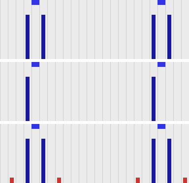

For a line on an odd column, which falls between two co-sited chroma samples, `zscale` and the corrected `scale`
put equal amounts in the samples either side. Plain `scale` puts it all in the sample to the left: it has
averaged the line with its neighbour into a single, centred value. The small red bars on the bottom row are
the bicubic filter's ringing.

## What each format records {#recorded-details}

What FFmpeg 9.0 writes, for frames that carry a chroma location:

| Codec | Field | 4:2:0 | 4:2:2 |
| :--- | :--- | :--- | :--- |
| H.264 | VUI `chroma_sample_loc_type` (4:2:0 only) | Written, except `left` (the default, which readers assume when nothing is written) | No field; assumed co-sited |
| HEVC (`libx265`) | VUI, as H.264 (4:2:0 only) | Written | No field |
| AV1 (`libsvtav1`) | `chroma_sample_position` (4:2:0 only) | `left` and `topleft` written; AV1 has no value for centred | No field |
| AV1 (`libaom-av1`) | as above | Always written as unknown: FFmpeg's `libaom` wrapper does not pass it on | No field |
| VP9 | None (not tested: no `libvpx` in our builds) | | |
| ProRes, DNxHD/DNxHR | None | | Assumed co-sited |

| Container | Field | Behaviour |
| :--- | :--- | :--- |
| Matroska / WebM | `ChromaSitingHorz`, `ChromaSitingVert` | Written for every codec and subsampling, and read back by FFmpeg. The only container here that records siting for every codec and FFmpeg reads back. |
| MXF | `ColorSiting` | Written, but not read back by FFmpeg. With no location on the frames, 4:2:2 is written as 0 (co-sited). FFmpeg maps `left` to 6 and `center` to 3 whatever the subsampling, which are ST 377-1's 4:2:0 values; for 4:2:2 the matching values would be 0 and 1. |
| MOV / MP4 | None | Only what the codec stream itself carries. |

### DNxHR in MXF

MXF does record siting, which makes a mismatch worse rather than better: the file states the wrong thing.
Encoding the test chart to DNxHR HQX 4:2:2 in MXF (OP1a and OP-Atom gave the same results; also the same on 6.0,
7.1 and 9.0):

| Command | MXF `ColorSiting` | Chroma actually is |
| :--- | :--- | :--- |
| `scale=in_range=full:in_color_matrix=bt709:out_range=tv:out_color_matrix=bt709` | 0, co-sited | **centred**: the label is wrong |
| `zscale=rangein=full:matrix=709:range=limited` | 0, co-sited | co-sited |
| `zscale=...:chromal=left` | 6, vertical midpoint | co-sited, but the label is odd for 4:2:2 |
| `scale` with `out_chroma_loc=left` and `full_chroma_inp` | 6, vertical midpoint | co-sited |

FFmpeg names 4:2:2 co-siting `topleft`, and maps `left` to MXF value 6, "vertical midpoint", which ST 377-1
defines as the MPEG-2 and H.264 4:2:0 position. For 4:2:2 that is the wrong value: a reader that takes it
literally sees 4:2:0 siting on 4:2:2 material. So for 4:2:2 MXF, leave `zscale`'s chroma location at its default
(or use `topleft`), which gives 0; do not set it to `left`.

## Reading back to RGB, measured {#reading-back-results}

Measured by decoding 4:2:2 and 4:2:0
versions of the test chart with known siting to 16-bit RGB PNG, with and without a chroma location tag (FFV1 in
Matroska, which carries the tag through to FFmpeg's decoder). Positions are in luma samples: 0 is co-sited, 0.5
centred.

| Converter | Tagged `left` or `topleft` | Tagged `center` | No tag (chroma co-sited) |
| :--- | :--- | :--- | :--- |
| `zscale` | Correct | Correct | Assumes co-sited: correct |
| `scale`, or no filter, 6.1 to 9.0 | **Assumes centred: chroma 0.5 to the right** | Correct | **Assumes centred: 0.5 to the right** |
| `scale`, or no filter, 9.1.dev | Follows the tag (within 0.07) | Correct | **Assumes centred: 0.5 to the right** |

The results were the same on 6.1.6, 7.0, 7.1.5, 8.0.1, 8.1 and 9.0.2; the 9.1 development build (N-127508) is
the only one that differs, and only for coarse detail when converting to packed RGB such as PNG: the finest
chroma detail still comes out as if centred (see [How it works](#how-it-works)). `-sws_flags +full_chroma_int` (or `scale=flags=...+full_chroma_int`) makes libswscale
interpolate the chroma instead of repeating each sample across two pixels, which it otherwise does when converting
4:2:x to RGB, but it does not change the position it assumes.

## The 4:2:2 player chart

Players and browsers make the same choice when they display 4:2:2, and most of them cannot be measured from a
script. For those there is a chart you look at instead: `sourceimages/chroma_siting_player_chart_422-prores.mov`
(ProRes 422 HQ), `-hevc.mp4` (HEVC 4:2:2 10-bit, which browsers play), `-h264.mp4` (lossless H.264 4:2:2
10-bit) and `-dnxhr.mxf` (DNxHR HQX), with a lossless FFV1 copy in `chroma_siting_player_chart_422-lossless.mkv`, and two
deliberately mislabelled files (see [Does the player read the label?](#reading-the-label)). They are made by
`sourceimages/make_chroma_siting_player_chart.py`. The chroma in every file is co-sited, and the encodes keep the
pattern intact (`zscale` decodes all of them exactly), so a wrong band is the player, not the file. Do not
re-encode them: heavier compression blurs the one-pixel stripes. For 4:2:0 there is a second chart, which tests
across and down separately; see [The 4:2:0 chart](#chart-420). To look at the pixels themselves, see [Checking the pixels](#pixel-chart).

### Reading the chart

1. **Show it at exactly 100%**: one image pixel per screen pixel ("1:1" in RV and xStudio, not "fit"; in a
   browser, page zoom 100% and a window wide enough for the whole frame). The patch at the top right is the
   check: from a distance its two halves should look equally bright. If the fine half looks darker, the player is
   scaling the picture, and the bands mean nothing.
2. **Step back**, or look at it from across the room. Each band is a checkerboard of striped blocks. The band
   that turns into a uniform field says how the player rebuilds the chroma. For a correct player that is the top
   one: H.264, HEVC, ProRes and DNxHD/DNxHR 4:2:2 are all co-sited.

| Band | Uniform when the player | Typical of |
| :--- | :--- | :--- |
| Co-sited (correct) | treats the chroma as co-sited and interpolates it | `zscale`; xStudio with the fix below |
| Centred, linear | treats it as centred, linear interpolation | GPU texture sampling (RV); libswscale `bilinear` |
| Centred, bicubic | treats it as centred, bicubic or lanczos | libswscale to planar RGB, or with `full_chroma_int` |
| Sample repeat | uses each chroma sample for two pixels | libswscale to packed RGB (e.g. writing a PNG), up to 9.0 |

If no band is uniform, the player is doing something else, for example converting to 4:2:0 or using the nearest
chroma sample. Look closer for stripes that should not be there (see Safari below).

What the chart looks like from a distance (simulated by averaging in linear light), decoded by `zscale` (left)
and by libswscale to planar RGB on 9.0 (right):

| `zscale`: top band uniform | libswscale, centred bicubic: third band uniform |
| :--- | :--- |
| 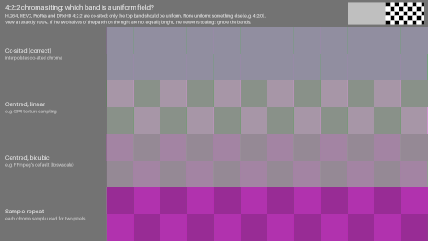 | 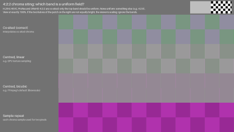 |

These are pictures of the result, already converted to RGB, so they look the same in any viewer. The test is the
video files.

### How it works

The test blocks have vertical stripes in a four-pixel cycle, with the two chroma samples on the even (co-sited)
columns. 4:2:2 keeps those and drops the odd columns, so the player has to rebuild the odd columns' chroma, and
how it does that depends on where it thinks the samples are. The reference blocks have the same stripes turned
through 90 degrees, which 4:2:2 holds exactly, since it has full vertical chroma resolution. Each band's
reference stripes are set to the pixels one kind of player makes from its test stripes. In the band that matches
the player, test and reference blocks then contain exactly the same pixels, so they match whatever the display,
its gamma, or a view transform such as ACES does to them.

The difference between the blocks only appears when the display turns each pixel into light and the eye averages
it. Y'CbCr to R'G'B' is linear, so the average code value of a test block is the same for every player. A viewer
that shrinks the picture averages code values before the display does, which removes the difference. At half
size or less a wrong player then looks right, hence the scale check, which is also pure black and white for the
same reason. The colours were chosen so that each wrong band differs from the right one by at least 0.04 in Oklab
(linear-light means, gamma 2.4), with every pixel in gamut for every kind of player, so the result does not
depend on clipping.

The chart tests the finest chroma detail 4:2:2 can hold. A player can place coarse colour correctly and still
fail here: FFmpeg 9.1.dev, decoding to packed RGB, puts a slow chroma sine within 0.03 pixel of the right place
but rebuilds the finest detail as a centred filter would, so the chart shows it as centred bicubic, while the
decode test in [Reading back to RGB](#reading-back-results), which blurs before it measures, sees it as co-sited.

### What players do

Measured on macOS 26 (Apple M2), from window screenshots at 1:1 (`screencapture -o -l`), with
`tests/chroma_siting_player_chart.py --capture`; Safari, OpenRV and xStudio were also checked by eye.

| Player | ProRes 422 HQ | HEVC 4:2:2 | H.264 4:2:2 |
| :--- | :--- | :--- | :--- |
| Safari 26.6.2 | **None uniform**: nearest sample, see below | Co-sited (correct) | Co-sited (correct) |
| Chrome 156 | Does not play | Co-sited (correct) | **Centred, linear** |
| Firefox 152 | Does not play | **None uniform**: vertical chroma also lost, as in 4:2:0 | Does not play |
| OpenRV 3.1.0 | **Centred, linear** | **Centred, linear** | **Centred, linear** |
| xStudio 1.4.0 | **Left half co-sited, right half sample repeat** | the same | the same |

FFmpeg, measured on the FFV1 copy with `python tests/chroma_siting_player_chart.py`:

| Conversion | 6.1.6 and 9.0.2 | 9.1.dev |
| :--- | :--- | :--- |
| `zscale` | Co-sited | Co-sited |
| No filter, to packed RGB (PNG, `rgb24`, `rgb48`) | **Sample repeat** | **Centred, bicubic** (finest detail only, see above) |
| No filter, to planar RGB (`gbrp16le`) | **Centred, bicubic** | Co-sited (the file is tagged `left`) |
| `scale=flags=bilinear+full_chroma_int` | **Centred, linear** | Co-sited |
| `scale=flags=bicubic+full_chroma_int`, `lanczos+full_chroma_int` | **Centred, bicubic** | Co-sited |

Notes on the players:

* **Chrome** shows HEVC correctly but not H.264 4:2:2. A likely explanation, not confirmed, is that HEVC is
  decoded and displayed by macOS, while 10-bit 4:2:2 H.264 is decoded in software and converted by Chrome
  itself. Edge (the same engine) was not measured.
* **Safari's ProRes** path takes each odd column's chroma from the nearest sample, but every odd column is exactly
  halfway between two samples, so floating-point rounding decides which one it gets. It switches between left and
  right in runs, which show as vertical stripes, and along a diagonal where the two triangles that draw the video
  frame meet. Over an area this is close to right (the top band is nearly uniform), but every odd pixel is wrong.
  The pattern also changes depending on whether the window is in front, and only one state can be captured.

  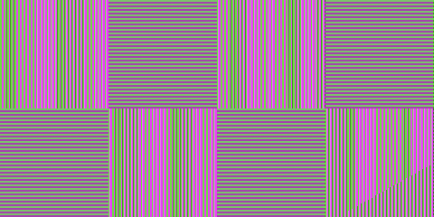
* **Firefox** keeps the horizontal siting but smears the chroma vertically, so the reference blocks are wrong too.
* **OpenRV** stores the file's chroma placement but does not use it: its shader samples the half-width chroma
  texture with linear filtering, which is centred.
* **xStudio** interpolates 10/12-bit 4:2:2 chroma correctly, but a bounds check in its YUV shader stopped it at
  the middle of the picture, and the right half repeats each sample. The same happens with VideoToolbox and with
  FFmpeg decoding. A [fix](https://github.com/AcademySoftwareFoundation/xstudio/pull/361) has been made (`image_coord.x*2 < frame_width_pixels` becomes `image_coord.x + 1 <
  frame_width_pixels` in `src/plugin/media_reader/ffmpeg/src/ffmpeg.cpp`) but is not yet merged. Its 8-bit path
  always repeats each sample.

  | xStudio 1.4.0: the top band changes half way across | With the fix |
  | :--- | :--- |
  | 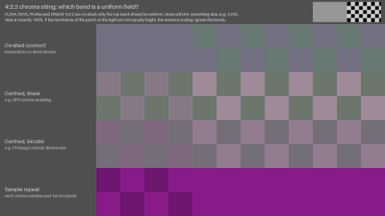 | 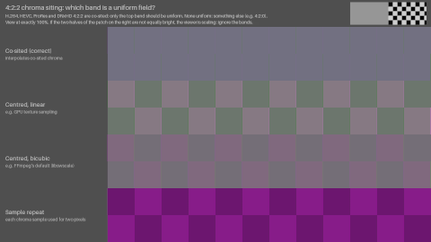 |

### Does the player read the label? {#reading-the-label}

MOV and MP4 have nowhere to record 4:2:2 siting, so with those files a player can only use its own assumption,
which is what the table above shows. Matroska and MXF can record it (see
[What each format records](#recorded-details)). To see whether a player reads that label,
there is a second copy of each with the same co-sited pixels and a label that says centred:

* `chroma_siting_player_chart_422-lossless.mkv` is labelled `left` (co-sited); `-labelled-center.mkv` is labelled `center`.
* `-dnxhr.mxf` has `ColorSiting` 0 (co-sited); `-dnxhr-labelled-center.mxf` has `ColorSiting` 1 (horizontal
  mid-point, ST 377-1's value for centred 4:2:2). FFmpeg cannot write 1 (it writes 3 for `center`, a 4:2:0
  value), so the generator patches that byte.

A player that ignores the label shows the same band for both files of a pair. One that reads it shows a centred
band for the mislabelled file, which is the right thing to do with a label even when, as here, the label is wrong.

| Player | MKV `left` / `center` | MXF `ColorSiting` 0 / 1 |
| :--- | :--- | :--- |
| FFmpeg `zscale` (9.0.2, 9.1.dev) | Co-sited / centred linear: **reads it** | Co-sited / co-sited: does not read it |
| FFmpeg, no filter, to planar RGB, 9.0.2 | Centred bicubic / centred bicubic: ignores it | Centred bicubic / centred bicubic |
| FFmpeg, no filter, to planar RGB, 9.1.dev | Co-sited / centred bicubic: **reads it** | Centred bicubic / centred bicubic: no label, so assumes centred |
| OpenRV 3.1.0 | Centred linear / centred linear: ignores it | Centred linear / centred linear: ignores it |

FFmpeg does not read MXF's `ColorSiting` at all, so neither does anything built on it. An MXF reader that does,
such as an edit or broadcast system, can be checked with the MXF pair; we have not tested one. Remember also that
FFmpeg writes 6 ("vertical midpoint", a 4:2:0 value) for 4:2:2 frames tagged `left`
([DNxHR in MXF](#dnxhr-in-mxf)), which such a reader might take literally.

What a browser draws into a `<canvas>` (`drawImage`) is not what it shows on screen: Safari's canvas was correct
for ProRes and Chrome's was wrong for HEVC, the reverse of the screen. So a page that reads the video back cannot
measure a browser; use screenshots, or your eyes.

## The 4:2:0 chart {#chart-420}

4:2:0 halves the chroma down as well as across, and the two can be wrong independently, so its chart has two
pairs of bands. It is `sourceimages/chroma_siting_player_chart_420-hevc.mp4` (HEVC Main 10, which browsers play)
and `-h264.mp4` (8-bit H.264 High, the most common delivery format), with a lossless FFV1 copy in
`chroma_siting_player_chart_420-lossless.mkv`, made by `sourceimages/make_chroma_siting_player_chart_420.py`. Read it the
same way (exactly 100%, the same scale check, from a distance), but expect two uniform bands, one per pair:

| Band | Uniform when the player treats the chroma as | Right for |
| :--- | :--- | :--- |
| Across: co-sited | co-sited across | H.264, HEVC, AV1 and BT.2020 4:2:0 |
| Across: centred | centred across (also sample repeat) | JPEG, MPEG-1 |
| Down: centred ("left") | centred down | H.264, HEVC and AV1 by default (FFmpeg's `left`) |
| Down: co-sited ("topleft") | co-sited down | BT.2020, and files tagged `topleft` |

So an ordinary H.264 or HEVC file should give "Across: co-sited" and "Down: centred". From a distance, decoded by
`zscale` (left, correct) and by libswscale on 9.0 (right, centred both ways):

| `zscale`: across co-sited, down centred | libswscale: across centred, down centred |
| :--- | :--- |
| 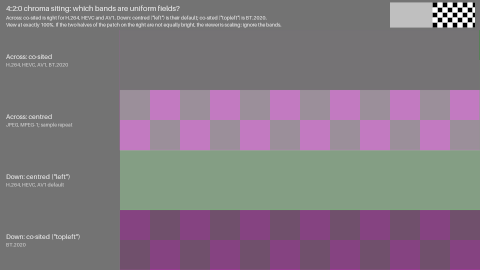 | 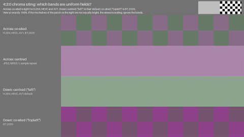 |

**How it works.** There is no direction in which 4:2:0 holds a reference block exactly, so each band compares a
striped pattern with its mirror image instead. The stripes run one way only (vertical stripes test across,
horizontal ones test down), so the other direction does not matter. If the mirror passes through a chroma sample,
any player that treats the samples as co-sited, with any symmetric filter, rebuilds the mirrored block as the
exact mirror image of the original: the two contain the same pixels and the band is uniform. A player that thinks
the samples are centred pairs luma and chroma differently in the two blocks, and the checkerboard shows. Mirrored
between two pixels instead, it is the other way round. The right band matches exactly whatever the filter, and
the colours were chosen so the wrong one differs by at least 0.065 (Oklab, linear light), all in gamut. Each band
has its own colours, so a uniform band's colour means nothing; only which bands are uniform does. Unlike the
4:2:2 chart, it does not tell linear from bicubic; it only answers where the player thinks the samples are.

The chroma in these files has no true position: the bands show what the player assumes, and which is right
depends on the label. In 4:2:0, H.264 and HEVC can carry a chroma location in the VUI, so there are deliberately
tagged copies with the same pixels: `-hevc-topleft.mp4`, `-hevc-center.mp4`, `-h264-topleft.mp4` and
`-h264-center.mp4`. A player that reads the tag should switch to "Down: co-sited" for `topleft`, and to "Across:
centred" for `center`. The H.264 files are 8-bit, so that browsers play them; `-h264-10bit.mp4` (High 10, with
`-topleft` and `-center` copies) and `-hevc-8bit.mp4` separate the codec from the bit depth in a player that
treats them differently.

Measured on macOS 26 (Apple M2) from window screenshots at 1:1, as for 4:2:2:

| Player | HEVC 10-bit, `left` | HEVC 10-bit, `topleft` | H.264 8-bit, untagged | H.264 10-bit, untagged | H.264 8-bit, `topleft` | H.264 8-bit, `center` |
| :--- | :--- | :--- | :--- | :--- | :--- | :--- |
| Safari 26.6.2 | Correct | Follows the tag | Correct | Correct | **Centred both ways** | Follows the tag |
| Chrome 156 | Correct | Follows the tag | Correct | **Centred across** | **Centred both ways** | Follows the tag |
| Firefox 152 | Correct | **Ignores the tag** | Correct | Correct | **Ignores the tag** | **Ignores the tag** |
| OpenRV 3.1.0 | **Centred across** | **Centred both ways** | **Centred across** | **Centred across** | **Centred both ways** | Centred both ways |
| xStudio, with the 4:2:2 fix | Correct | **Ignores the tag** | **Centred across** | Correct | **Ignores the tag** | not tested |

"Correct" is across co-sited and down centred. All of them play 10-bit H.264, but Chrome shows it centred
across, though it gets 8-bit H.264 right. Otherwise Safari and Chrome agree, including an H.264 file tagged
`topleft` coming out centred both ways, which matches neither the tag nor the default; both decode H.264 and HEVC
through macOS, which is the likely common cause, but that is not confirmed. In xStudio it is the bit
depth, not the codec, that matters: 10-bit H.264 is correct and 8-bit HEVC is centred across. Its shader averages
neighbouring chroma samples across only in its 10/12-bit path, and repeats rows (centred down) in both; it ignored
every tag we tried (HEVC `topleft` and `center`, 8-bit H.264 `topleft`, 10-bit H.264 `center`). OpenRV is centred
both ways whatever the file says.

FFmpeg, with `python tests/chroma_siting_player_chart.py --chart sourceimages/chroma_siting_player_chart_420-...`:

| Conversion | 6.1.6 and 9.0.2 | 9.1.dev |
| :--- | :--- | :--- |
| `zscale` | Follows the tag (`left`, `topleft`, `center`) | Follows the tag |
| No filter, to planar RGB | **Centred both ways**, whatever the tag | Follows the tag |
| No filter, to packed RGB (PNG) | **Centred both ways**, whatever the tag | **Centred both ways**, whatever the tag (the finest detail; see [How it works](#how-it-works)) |
| `scale=flags=...+full_chroma_int` | **Centred both ways** | Follows the tag |

## Checking the pixels {#pixel-chart}

The charts above depend on display gamma and the eye. To check their answer directly, or to show that a particular
player is wrong, there are also tiny 64x64 charts to zoom in on. In each, the luma is flat grey and single chroma
samples are raised, so the only thing that can spread the colour is the player's chroma reconstruction:

| The player assumes | Weight of the sample in the columns tick-1, tick, tick+1, tick+2 | The colour is centred |
| :--- | :--- | :--- |
| Co-sited, interpolated | .5, 1, .5, 0 | **on the tick** |
| Centred, linear | .25, .75, .75, .25 | between the tick and the next column |
| Sample repeat | 0, 1, 1, 0 | between the tick and the next column |

The long ticks in the luma rulers mark the column (and, in 4:2:0, the row) of the raised sample; the short ones mark
every chroma site. There are three cells across, so a fault in only part of the picture shows. For 4:2:0 the same
reading applies down the picture against the left ruler, where the `left` default is centred *between* the tick and
the next row.

Open the test file and its reference in the same player and flip between them at the same zoom. The reference is
4:4:4, so the player has no chroma to reconstruct, and it goes through the same view transform. These are the
references, enlarged:

| 4:2:2: one assumption per row | 4:2:0: across by column, down by row |
| :--- | :--- |
| 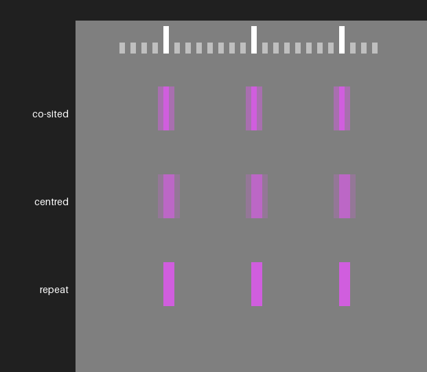 | 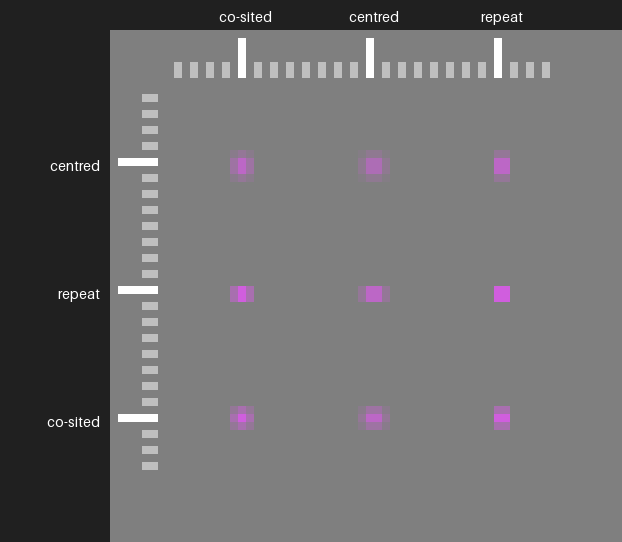 |

Most of each reference shows what wrong players do. Only the top row of the 4:2:2 reference and the top-left square of
the 4:2:0 reference are correct for H.264, HEVC, ProRes and DNxHD/DNxHR. A correct player makes every cell of the test
file look like that:

| 4:2:2: what a correct player shows | 4:2:0: what a correct player shows |
| :--- | :--- |
| 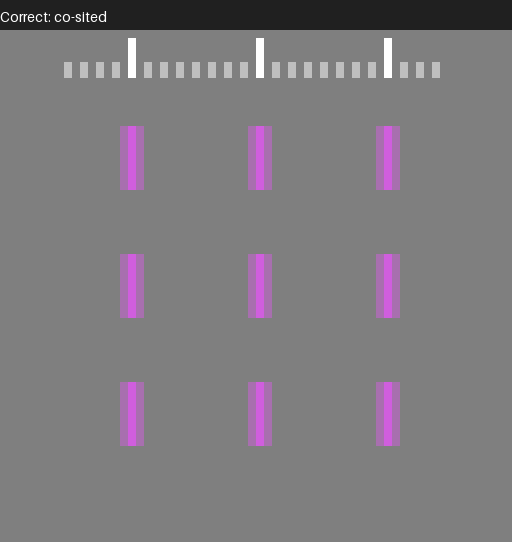 | 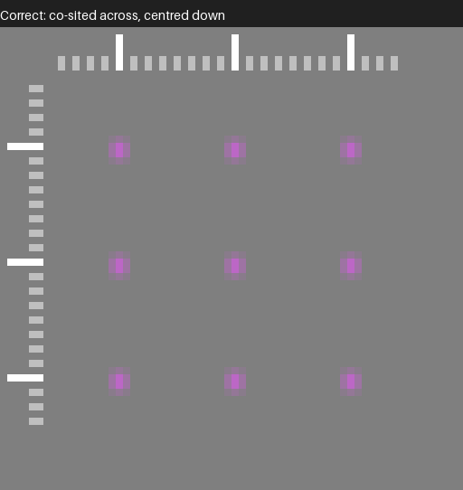 |

These are the exact pixels, enlarged without smoothing. They match the test files decoded with `zscale` to within about
1 code value in 10 bits, or about one 8-bit code for the 8-bit files (FFmpeg 6.1.6, 7.1.5, 8.1, 9.0.2 and the 9.1
development build, N-127508).

The files are in `sourceimages/`, lossless FFV1 in Matroska, so they are for desktop players and not browsers:
`chroma_siting_pixel_chart_422-10bit.mkv`, `_422-8bit.mkv`, `_420-10bit.mkv`, `_420-8bit.mkv`, and
`_422-reference.mkv`, `_420-reference.mkv`.

How a player zooms matters:

* **xStudio** computes each image pixel in its shader, so any zoom shows the real values. Trust the screen, not the
  pixel probe: the probe is separate code, and did not have the half-width bug that the screen did.
* **OpenRV** applies its filter setting (`n` toggles it) to the chroma planes as well as the luma. Under Linear, the
  default, a zoomed view is smooth, but the peak of the colour is where the chroma is. Under Nearest the chroma
  becomes sample repeat across, which is not what RV shows at normal playback, although the colour is still centred
  half a pixel to the right. Down the picture, 8-bit 4:2:0 is repeated too, but 10-bit 4:2:0 stays blended, so the two
  look different (OpenRV 3.1.0). Check the chroma position, not the pixel shapes, or use Linear.

Players were measured on macOS 26 (Apple M2) from window screenshots, sampled at the centre of each image pixel, with
`tests/chroma_siting_pixel_chart.py --capture`. FFmpeg was measured by the same script on 6.1.6, 7.1.5, 8.1, 9.0.2 and
the 9.1 development build (N-127508); the results are the same on all of them except where a row says so:

| Player or conversion | 4:2:2 10-bit | 4:2:2 8-bit | 4:2:0 10-bit | 4:2:0 8-bit |
| :--- | :--- | :--- | :--- | :--- |
| `zscale` | Co-sited | Co-sited | Co-sited across, centred down | Co-sited across, centred down |
| No filter, to planar RGB, up to 9.0.2 | **Centred** | **Centred** | **Centred both ways** | **Centred both ways** |
| No filter, to planar RGB, 9.1.dev (the files are tagged `left`) | Co-sited | Co-sited | Co-sited across, centred down | Co-sited across, centred down |
| No filter, to packed RGB | **Sample repeat** (see below for 9.1.dev) | **Sample repeat** | **Repeat across**, centred down (see below for 9.1.dev) | **Repeat both ways** |
| OpenRV 3.1.0 (Linear) | **Centred** | **Centred** | **Centred both ways** | **Centred both ways** |
| xStudio, with the 4:2:2 fix | Co-sited | **Sample repeat** | Co-sited across, repeat down | **Repeat both ways** |
| xStudio 1.4.0 | **Co-sited at x=16, mixed at 32, repeat at 48** | **Sample repeat** | **Across as for 4:2:2**, repeat down | **Repeat both ways** |

Wherever a larger chart covers the same case the two agree, so each confirms the other (the 4:2:2 chart has no
8-bit version, so 8-bit 4:2:2 is only measured here). 10-bit to packed RGB is the exception on 9.1.dev: sample repeat
is still the nearest of the patterns this chart models, but it is a poor match, and the 4:2:2 player chart reads that
conversion as centred bicubic. "Repeat down" puts the 4:2:0
chroma in the right place for H.264 and HEVC (centred between the rows) but without interpolating it.

## How this was tested

* `sourceimages/chroma_siting_chart.png`, generated by `sourceimages/make_chroma_siting_chart.py` and described
  in `sourceimages/README.md`, has linear "tents" in blue that peak exactly between two columns (rows), and
  single-pixel lines on even and odd columns (rows).
* The chroma position is where the two sides of the tent meet in the converted chroma plane: a symmetric filter
  on a linear ramp returns the ramp's value at the filter's centre, so this gives the sample position
  independently of the filter, gain or offset. The lines give the same position a second way, and show whether
  even and odd columns are treated alike.
* All conversions are to 16-bit 4:2:2 and 4:2:0 written as raw video, so no codec is involved, except the
  tagging and DNxHR tests, which encode with each codec.

```console
python tests/chroma_siting.py --label 9.0      # once per FFmpeg version
python tests/chroma_siting.py --summarize      # tests/chroma-siting/summary.md
python tests/chroma_siting_containers.py --label 9.0
python tests/chroma_siting_images.py
```

Each script measures whichever `ffmpeg` is on the `PATH` (or `FFMPEG_BIN` and `FFPROBE_BIN`). Run it once per
FFmpeg version with `--label`, then `--summarize` combines the runs into the script's `summary.md`. With a rez
setup that has an `ffmpeg-<version>` package per version, `--rez 6.0 7.0 ...` does both. The scripts need numpy
and the OpenImageIO Python bindings (`requirements.txt`).

The same measurements, and the reverse direction, are also part of the encoding test framework, so they are re-run
for each FFmpeg version (`enctests/test_configs/chroma_siting_tests.yml` and `decode_siting_tests.yml`). For the
reverse direction, `sourceimages/make_chroma_siting_sources.py` subsamples the chart in numpy at a known siting
and stores it as FFV1 in Matroska. The decoded RGB is converted back to full-resolution chroma, and compared with
the ideal chroma of the chart shifted by a fraction of a pixel; the shift that matches best is how far the
decoder moved the chroma. Both are blurred first, so the converter's own filter does not affect the result.

The player chart is measured with `tests/chroma_siting_player_chart.py`: on its own it decodes the FFV1 copy with
`zscale` and libswscale; with `--capture` it reads screenshots instead. For each band it gives the difference
between the test and reference blocks as they would look from a distance (Oklab distance between their
linear-light means), the scale check, and, for the top band, which blocks match pixel for pixel, left to right,
which is how the xStudio bug showed.

## Where this is specified

| Specification | What it says |
| :--- | :--- |
| [ITU-R BT.601-7](https://www.itu.int/rec/R-REC-BT.601) (SD), Part A, sampling structure | "C<sub>R</sub> and C<sub>B</sub> samples co-sited with odd (1st, 3rd, 5th, etc.) Y samples in each line" |
| [ITU-R BT.709-6](https://www.itu.int/rec/R-REC-BT.709) (HD), item 4.3 | C<sub>B</sub>, C<sub>R</sub> "co-sited with each other and with alternate Y samples", "the first active colour-difference samples being co-sited with the first active luminance sample" |
| [ITU-R BT.2020-2](https://www.itu.int/rec/R-REC-BT.2020) (UHD), Table 5 | For 4:2:2 and 4:2:0: "The first (top-left) sample is co-sited with the first Y' samples" |
| [ITU-T H.264](https://www.itu.int/rec/T-REC-H.264) and [ITU-T H.265](https://www.itu.int/rec/T-REC-H.265), Annex E (VUI) | `chroma_sample_loc_type_top_field` / `_bottom_field`, values 0 to 5, for 4:2:0 only, shown in Figure E-1. 0 (left: co-sited horizontally, centred vertically) is the default when nothing is signalled. |
| [ITU-T H.273](https://www.itu.int/rec/T-REC-H.273) (07/21 and later) | Adds a coding-independent code point for the 4:2:0 chroma sampling grid alignment, alongside the familiar primaries, transfer and matrix code points |
| [AV1 specification](https://aomediacodec.github.io/av1-spec/#color-config-semantics), colour config semantics | `chroma_sample_position`, 4:2:0 only: 0 unknown, 1 `CSP_VERTICAL` "horizontally co-located with (0, 0) luma sample, vertical position in the middle between two luma samples", 2 `CSP_COLOCATED` "co-located with (0, 0) luma sample". There is no value for centred. |
| [Matroska, RFC 9559](https://www.rfc-editor.org/rfc/rfc9559#section-5.1.4.1.28.23) sections 5.1.4.1.28.23 and .24 | `ChromaSitingHorz`: 0 unspecified, 1 left collocated, 2 half. `ChromaSitingVert`: 0 unspecified, 1 top collocated, 2 half. |
| SMPTE ST 377-1:2019 (MXF), section G.2.29, CDCI picture descriptor | `ColorSiting`: 0 coSiting, "as in ITU-R Rec 601, SMPTE ST 314 4:1:1 or MPEG-2 4:2:2"; 1 horizontal mid-point; 3 quincunx, "as in MPEG-1 4:2:0"; 4 Rec601 (equivalent to 0, deprecated); 5 line alternating; 6 vertical midpoint, "as in MPEG-2 4:2:0 and H.264/AVC 4:2:0"; 255 unknown, the default when absent. (SMPTE standards are not freely available.) |
| FFmpeg [`AVChromaLocation`](https://github.com/FFmpeg/FFmpeg/blob/master/libavutil/pixfmt.h) (`libavutil/pixfmt.h`) | FFmpeg's own names, with a diagram: `left` is "MPEG-2/4 4:2:0, H.264 default for 4:2:0", `center` is "MPEG-1 4:2:0, JPEG 4:2:0", `topleft` is "ITU-R 601, SMPTE 274M ..., mpeg2 4:2:2" |

So in FFmpeg's terms, professional 4:2:2 is `topleft` (for 4:2:2, which has no vertical subsampling, `left` and
`topleft` put the chroma in the same place), H.264/HEVC 4:2:0 is `left`, and BT.2020 4:2:0 is `topleft`.
