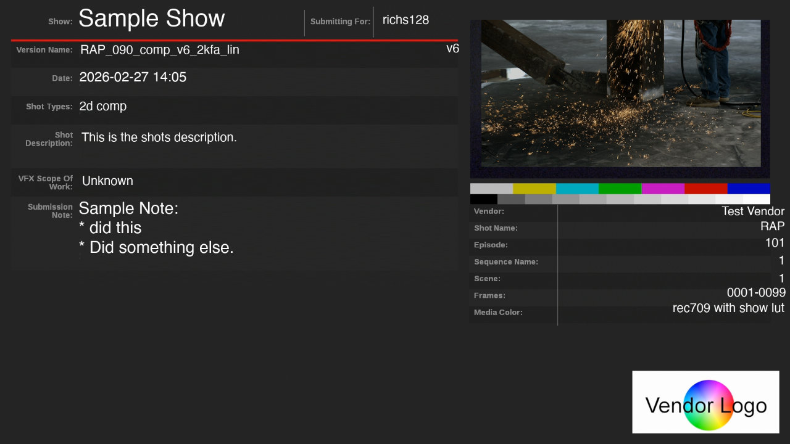
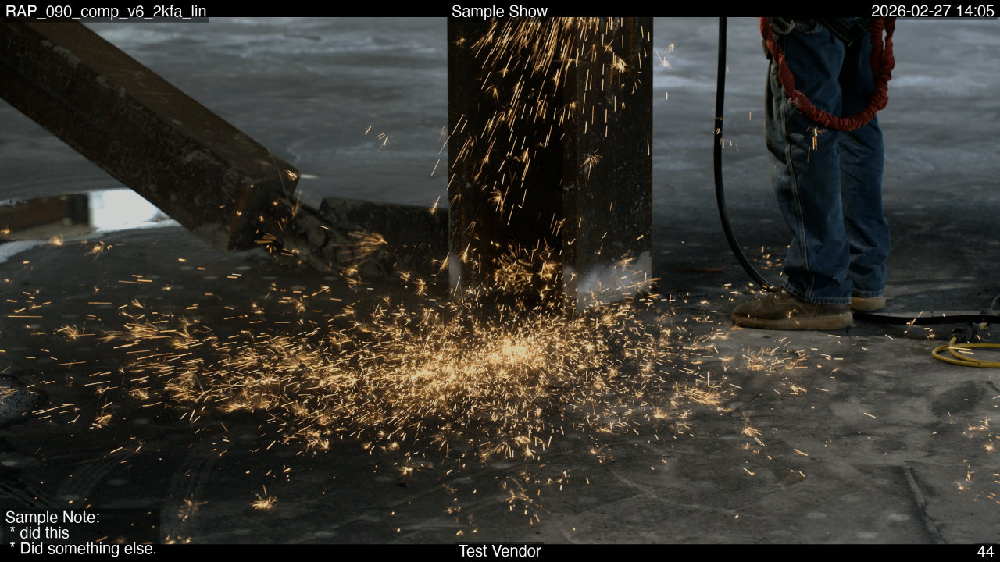

# FFmpeg OCIO Filter

<details open markdown="block">
  <summary>
    Table of contents
  </summary>
  {: .text-delta }
1. TOC
{:toc}
</details>

With the introduction of FFmpeg 8.1 a [OCIO](https://ocio.readthedocs.io/en/latest/) [filter](https://ffmpeg.org/ffmpeg-filters.html#ocio) has been added. This allows you to convert from EXR files directly to encoded media using an OCIO filter to convert the colorspace correctly without needing an intermediate file.

If you are encoding to YCbCr, you should perform the OCIO conversion in an RGB colorspace first, and then convert to YCbCr with `zscale`, in the same way as the other pages on this site (see [zscale Conversion](EncodeZscale.html)):

```console
ocio=...:format=rgb48,format=rgb48le,zscale=matrix=709:range=limited:filter=lanczos,setparams=color_primaries=bt709:color_trc=iec61966-2-1
```

* **`setparams` is essential here.** The OCIO filter changes the pixels but not the frame's colour tags, and FFmpeg 9.0 tags EXR frames as linear. Without `setparams`, the file is labelled with a linear transfer function and no primaries, whatever display transform you applied. The earlier examples on this page did exactly that.
* **`zscale` rather than `scale`.** libswscale puts white about 3 code values (10-bit) too high, as on the other pages; see [Colour range accuracy](EncodeSwsScale.html#colour-range-accuracy-prefer-zscale-for-range-conversions).
* **`format=rgb48le` between the two filters** works around a crash in the FFmpeg 9.0 release, which segfaults when `zscale` follows the OCIO filter directly. It changes nothing (`rgb48` already is `rgb48le`), and builds with the format negotiation rework (our 8.1 build, and 9.1-dev) do not need it; see [Building ffmpeg with OCIO support](#building-ffmpeg-with-ocio-support).

Measured on 9.0 against the OCIO filter's own RGB output (ACES sRGB display transform, H.264 4:2:0 10-bit, `-crf 18`): the earlier `scale` version was white +3.0, mean error 1.7, tagged linear transfer with no `colr` atom; the `zscale` version is white 0.0, mean error 1.3, tagged BT.709/sRGB (`colr` `nclc 1/13/1`).

## Example Usage

### Using OCIO-Display

This example is encoding to a 10-bit h264 quicktime.

```console
ffmpeg -y  -framerate 24 -start_number <STARTFRAME> -i SOURCEFRAMES.%05d.exr \
   -c:v libx264 -pix_fmt yuv420p10le -crf 18 -preset slow \
   -vf "ocio=input=ACEScct:display=sRGB - Display:view=ACES 1.0 - SDR Video:format=rgb48,format=rgb48le,zscale=matrix=709:range=limited:filter=lanczos,setparams=color_primaries=bt709:color_trc=iec61966-2-1" \
   OUTPUTFILE.mov
```

### Using an output colorspace (in this case ACEScct)

This is using the older style colorspace conversion where you are specifying an output colorspace (in this case ACEScct).

```console
ffmpeg -y  -framerate 24 -start_number <STARTFRAME> -i SOURCEFRAMES.%05d.exr \
   -c:v libx264 -pix_fmt yuv420p10le -crf 18 -preset slow \
   -vf "ocio=input=ACEScg:output=ACEScct:format=rgb48,format=rgb48le,zscale=matrix=709:range=limited:filter=lanczos,setparams=color_primaries=unknown:color_trc=unknown" \
   OUTPUTFILE.mov
```

ACEScct has no standard primaries or transfer code, so this leaves them unspecified rather than letting the EXR's linear tag through. Anything that reads the file needs to be told it is ACEScct.

The format parameter that's part of the OCIO filter allows you to specify an output pixel_format that OCIO will be converting to. This has to be an RGB colorspace since OCIO doesn't know how to convert to YCbCr. If you do not supply the format, the output will match the input with the exception of half-floats which will be converted to full floats (due to poor support for half-floats).

Note, you can also specify the OCIO config file as a "config" parameter; otherwise, it will default to the `OCIO` environment variable.

## Creating an HDR movie from ACEScg

This example demonstrates how to convert an ACEScg EXR image sequence to a 10-bit HDR10 (PQ) QuickTime movie.

This is converting from a ACEScg image sequence to a HDR PQ quicktime.

```console
ffmpeg -y -framerate 24 -start_number <STARTFRAME> -i SOURCEFRAMES.%04d.exr -c:v libx265 -pix_fmt yuv422p10le -threads 0 -vf "ocio=input=ACEScg:display=Rec.2100-PQ - Display:view=ACES 1.1 - HDR Video (1000 nits & Rec.2020 lim):format=rgb48,format=rgb48le,zscale=matrix=2020_ncl:range=limited:filter=lanczos,setparams=color_primaries=bt2020:color_trc=smpte2084" -color_range tv -color_trc smpte2084 -color_primaries bt2020 -colorspace bt2020nc -tag:v hvc1  \
    -x265-params "hdr-opt=1:colorprim=bt2020:transfer=smpte2084:colormatrix=bt2020nc:range=limited:master-display=G(13250,34500)B(7500,3000)R(34000,16000)WP(15635,16450)L(10000000,1):max-cll=1000,400" OUTPUTFILE.mov
```

## Converting an HDR movie back to ACEScg EXRs

To demonstrate converting from an HDR movie back to ACEScg, we first create a high-quality (lossless 12-bit 4:4:4) HDR movie:

To test converting from an HDR movie, we are going to create an HDR movie first:

```console
ffmpeg -y -framerate 24 -start_number 6100 -i <INPUTFILE>.%05d.exr -c:v libx265 -pix_fmt yuv444p12le -vf "ocio=input=ACEScg:display=Rec.2100-PQ - Display:view=ACES 1.1 - HDR Video (1000 nits & Rec.2020 lim):format=rgb48,format=rgb48le,zscale=matrix=2020_ncl:range=limited:filter=lanczos,setparams=color_primaries=bt2020:color_trc=smpte2084" -color_range tv -color_trc smpte2084 -color_primaries bt2020 -colorspace bt2020nc -tag:v hvc1      -x265-params "lossless=1:hdr-opt=1:colorprim=bt2020:transfer=smpte2084:colormatrix=bt2020nc:range=limited:master-display=G(13250,34500)B(7500,3000)R(34000,16000)WP(15635,16450)L(10000000,1):max-cll=1000,400" sparks_lossless_h265.mov
```

Note this is both 12-bit 444 and lossless, to make the comparison a little easier to rule out any encoding artifacts.

Then we can convert it back to EXR's:

```console
ffmpeg -y -i sparks_lossless_h265.mov -threads 0 -vf "zscale=filter=lanczos,format=gbrpf32le,ocio=input=ACEScg:display=Rec.2100-PQ - Display:view=ACES 1.1 - HDR Video (1000 nits & Rec.2020 lim):inverse=1:format=gbrpf32le"  testoutput/testoutput.%04d.exr
```

`zscale` converts the Y'CbCr to floating point RGB before the OCIO filter, reading the matrix and range from the file's tags. The earlier version of this command left that conversion to libswscale and put `scale` after the OCIO filter, where it clamps the scene-linear values. Converting a lossless 12-bit PQ movie of an ACEScg frame back (9.0 and 9.1-dev), the median error against the original EXR went from 1.0% to 0.12%, and the brightest value kept from 299 to 707 (the source peaks at 2100; the 1000 nit display transform cannot carry all of it).

So while this will limit the max luminance to 1000 nits, it will give you a wide gamut with an higher dynamic range that you can convert back into a linear range which will be hugely superior to rec709 or Display P3. Obviously this is not as good as using the original EXR files, but it is certainly an improvement over rec709, giving you the ability to change the exposure

If your viewer supported HDR, this shows that you could internally convert it to ACEScg, so that any test color correction you might be doing in the viewer would be fairly representative of what it would be like if you were reading from an openEXR frame. Obviously the best results would be to use the EXR frames, but its certainly an improvement over rec709.

## Converting from HDR (Rec.2100) image sequence to ACEScg

If you have an image sequence that is already in an HDR space (like Rec.2100 PQ) and want to convert it to ACEScg EXRs, you can use the `inverse=1` parameter with the appropriate display and view:

```console
ffmpeg -y -i INPUT_REC2100.%04d.exr -vf "ocio=input=ACEScg:display=Rec.2100-PQ - Display:view=ACES 1.1 - HDR Video (1000 nits & Rec.2020 lim):inverse=1:format=gbrpf32le" testoutput_acescg.%04d.exr
```

## Filter Arguments

| Option | Description |
| ------ | ----------- |
| config | By default the filter will use the OCIO config defined by the OCIO environment variable, but this parameter allows you to explicitly specify its location. If you are getting started, you can use config=ocio://studio-config-v1.0.0_aces-v1.3_ocio-v2.1 which specifies one of the built in defaults. |
| input | Set the input colorspace. |
| output | Set the output colorspace. |
| display | Set the display colorspace, used in combination with view. |
| view | Set the view colorspace, used in combination with display. |
| inverse | When used in combination with display and view, this inverts the transform, so going from a display/view to the "input colorspace". |
| format | Allow you to specify the output pix_fmt of the OCIO filter. This *has* to be a RGB colorspace, so you really are limited to rgb24, rgba, rgb48, rgba48, gbrp10, gbrp12, gbrpf32le, gbrapf32le, for most encoding we would recommend rgb48. By default this is the pix_fmt of the input with the exception of gbrpf16le which we automatically convert to a 32bit version (half float is not fully supported by ffmpeg, swscale in particular). Note that choosing an integer format such as rgb48 also **clamps** the result to the 0.0 - 1.0 range. That is usually what you want for a display-referred output, and it matches what Nuke does, but it is a real choice: a display transform can emit values outside that range, and leaving `format` unset carries them through to the YCbCr conversion where they become illegal levels. |
| context_params | Allow you to specify additional context parameters for the OCIO filter. This is a list of key=value pairs, separated by colons. |

## Working with EXR files and FFmpeg

FFmpeg has its own implementation of libOpenEXR support, and this can lead to some differences in how it handles EXR files. For example, some of the newer features (such as HTJ2K compression) may not be supported. Also floating point may not be supported in all filters, so you should test your pipelines to ensure that they are working as expected. Things to watch out for include:

* **swscale cannot resize scene-linear data.** The `scale` filter has no half-float support at all, and it clamps floating point values to the 0.0 - 1.0 range internally. Feeding it a range of -2.0 to 300.0 returns 0.499 to 1.0. Since EXR decodes natively as half-float, `scale` will silently discard every highlight above 1.0. Converting to 32-bit float first does **not** help — the clamp is inside swscale, not in the conversion into it. Use `zscale` instead, which handles both half-float and 32-bit float correctly and preserves the full range.
* **Converting half-float to 32-bit float with swscale also clamps.** Asking ffmpeg for a `gbrpf32le` output from a half-float source routes through a swscale conversion that clamps to 0.0 - 1.0. If you want to inspect the true values of an EXR, read the half-float directly rather than asking for a 32-bit float dump.
* While FFmpeg can write exr files, we would recommend using tools such as oiiotool that do use OpenEXR library to ensure that all features of the library are supported.

### What happens to out-of-range values if you do not clamp

The `format` you give the OCIO filter decides whether out-of-range values reach the file. An integer format such as `rgb48` clamps to 0.0 - 1.0 inside the filter. A float format such as `gbrpf32le` (or leaving `format` unset with a float source) keeps them, and `zscale` then writes them into the Y'CbCr as luma outside the 64-940 range (at 10-bit). It only clips at the ends of the code range, 0 and 1023. The encoder will not clamp them either: 0 to 1023 are all valid values in a 10-bit bitstream, and the 64-940 range is a signalling convention rather than something the codec enforces.

Grey float RGB converted to 10-bit limited range with `zscale`, then back to 16-bit RGB with `zscale` as a player would (FFmpeg 7.1 and 8.1):

| RGB in | -0.1 | -0.05 | 0.0 | 0.5 | 1.0 | 1.05 | 1.1 | 1.5 |
| :--- | ---: | ---: | ---: | ---: | ---: | ---: | ---: | ---: |
| 10-bit Y' | 0 | 20 | 64 | 502 | 940 | 984 | 1023 | 1023 |
| Back to 16-bit RGB | 0 | 0 | 0 | 32767 | 65535 | 65535 | 65535 | 65535 |

Values below black and above white survive into the file but are clipped by the conversion back to RGB, so they are not recoverable in practice. Players that convert differently, or apps that show the raw Y'CbCr, may not treat them the same way. Unless you deliberately want to keep super-whites, set an integer `format` on the OCIO filter so the clamp happens in a known place.

## Filter order: resizing before or after the OCIO filter

If you need to resize as well as colour convert, the order matters for both correctness and speed.

### Resizing first is faster

The OCIO filter is the expensive part of the chain, so resizing first means it processes fewer pixels. Converting a 1920x1080 ACES sequence through a display transform to 10-bit YCbCr, 20 frames, best of three runs:

| Chain | Time per frame |
| :--- | ---: |
| ocio then resize to 960x540 | 27.8 ms |
| resize to 960x540 then ocio | 10.5 ms |
| ocio then resize to 1280x720 | 27.6 ms |
| resize to 1280x720 then ocio | 15.4 ms |

Resizing first is 1.8x to 2.6x faster, and the saving scales with how much you are reducing by, because the OCIO filter always runs at full resolution in the other ordering.

### Resizing first also matches Nuke

Nuke resamples in the working space and applies the display transform afterwards. Comparing both orderings in FFmpeg against uncompressed Nuke renders of the same sequence, resize-first matches by roughly 12 dB more than ocio-first does. If your goal is to match a Nuke-generated reference, resize first.

### But it has two requirements

{: .warning }
> Resizing before the OCIO filter must use `zscale`, not `scale`. As described above, `scale` clamps floating point to 0.0 - 1.0, so resizing scene-linear EXR data with it destroys every highlight before the display transform ever sees them.

The second requirement is FFmpeg 8.1 or newer *with the OCIO filter's format negotiation fix*. On the 8.1 release the filter graph cannot resolve formats for this ordering and the command fails outright:

```console
The following filters could not choose their formats: Parsed_ocio_1
Consider inserting the (a)format filter near their input or output.
```

Adding an explicit `format=` to the OCIO filter works around this on 8.1, since it is purely a negotiation failure:

```console
-vf "zscale=w=1280:h=720:filter=lanczos,ocio=input=ACEScg:display=sRGB - Display:view=ACES 1.0 - SDR Video:format=gbrpf32le"
```

Builds carrying the negotiation rework (see [below](#building-ffmpeg-with-ocio-support)) handle it without the explicit format.

### Resampling filter choice

Lanczos is the usual choice. Note that resampling scene-linear data rings against highlights before the transform compresses them — a frame with a scene-linear peak of 231.0 rings down to -5.4 in display-referred units after the transform. This is expected behaviour rather than a fault, but it makes the filter width worth thinking about: a 4-tap lanczos rings noticeably less than a 6-tap one.

If you are matching Nuke, its `Lanczos4` and `Lanczos6` are named by tap count and correspond to `zscale`'s `param_a=2` and `param_a=3` respectively. `zscale`'s default lanczos is `param_a=3`, so it matches Nuke's `Lanczos6`. Note that FFmpeg's help text describes `param_a` as "the number of filter taps", but it is actually the lobe count, with taps being twice that.

## Building ffmpeg with OCIO support

If you are already manually building ffmpeg, you can enable OCIO support by adding the following flag to the configure script:

```console
--enable-libopencolorio
```

This does require opencolorio to be installed on the system, and be found by pkg-config.

If not, you may want to refer to the docker container build files in the [docker](docker) directory. In particular the [rocky-ffmpeg-8.1](docker/rocky-ffmpeg-8.1) directory. There is also a conan recipe in the [conan](conan/README.md) directory that can be used to build ffmpeg with OCIO support on macOS, linux and windows.

We do also want to flag a patch that didnt make it into the ffmpeg 8.1 release - <https://code.ffmpeg.org/FFmpeg/FFmpeg/pulls/21799>. This reworks how the OCIO filter negotiates pixel formats with the filters around it. On the 8.1 release the format parameter is applied too late in negotiation, so downstream filters such as `zscale` can be handed the wrong pixel format, and chains that put a resize *before* the OCIO filter fail to resolve formats at all:

```console
The following filters could not choose their formats: Parsed_ocio_1
```

With the patch, those chains negotiate without needing an explicit `format=` to force the issue. Hopefully this will make it into the following release. The above build recipes do include this patch.

{: .note }
> We have measured the difference between the 8.1 release and a development build carrying this rework, and the resize-before-OCIO chain goes from failing outright to working. Strictly speaking the two builds differ by more than this one patch, so we describe the fix as being in the development build rather than attributing it to the patch alone.

## Timing Tests

For some simple timing tests, we are comparing oiiotool using --parallel-frames (meaning the initial conversion is run in as many threads as possible) and ffmpeg (both single threaded and with 4 threads). This is a 4 second 4k exr image sequence of 200 frames (sparks) and we are encoding to prores_videotoolbox 422 HQ on a M2 Macbook Pro. We picked this particular codec since its fast, and works at high bit-depths (10 and 12-bit).

| Task | Elapsed time Seconds | Notes |
| :--- | ---: | :--- |
| oiiotool | 101.46 | Media conversion to PNG serially. |
| oiiotool with parallel-frames | 44.91 | Media conversion to PNG with --parallel-frames |
| basic ffmpeg | 2.87 | Just converting the resulting frames from PNG to a quicktime |
| oiiotool + ffmpeg | 47.78 | Combining parallel-frames and the ffmpeg generation |
| ffmpeg with 0 threads | 19.58 | This is the default option |
| ffmpeg with 1 threads | 127.75 | Single threaded. |
| ffmpeg with 2 threads | 65.90 | |
| ffmpeg with 4 threads | 33.95 | |
| ffmpeg with 6 threads | 23.74 | |
| ffmpeg with 8 threads | 37.75 | |

We recommend leaving it with the default of 0 threads (i.e. dont specify anything). It is worth noting that OCIO using the CPU is not super fast (although clearly faster than the alternative), we will explore using vulkan to accelerate this in the future.

## Slate and burn-in generation

By adding OCIO to FFmpeg, we can generate slates and burn-ins in the correct colorspace without needing to create an intermediate file. This is critical for VFX pipelines where metadata must be overlaid on color-corrected plates.

For an extreme example of building a slate and burn-in, see the following example, which is generated using the prototype dailies tool [ffmpeg-dailies](https://github.com/richardssam/ffmpeg-dailies).

| Example slate | Example burn-ins |
| :---: | :---: |
|  |  |

this is storing the filter in a separate file, to make it more stable.

```console
ffmpeg -y \
    -framerate 24 -start_number 1001 \
    -i tests/data/complex_paths/shots/SH010/v001/SH010_v001.%04d.exr \
    -i vfx-templates-blank-slate-0.0.6.jpg \
    -/filter_complex filterfile.txt \
    -map "[final_v]" \
    -c:v libx264 -crf 18 -preset slow -pix_fmt yuv420p10le \
    -r 24 \
    -metadata comment="Sample Note:
 * did this
 * Did something else." \
    -metadata artist="Test Vendor" \
    -metadata shot_types="2d comp" \
    -metadata submit_for="richs128" \
    -metadata scope_of_work="Unknown" \
    -metadata shot_description="This is the shots description." \
    -metadata episode="101" \
    -metadata sequence_name="1" \
    -metadata scene="1" \
    -metadata media_color="rec709 with show lut" \
    -metadata title="Sample Show" \
    -metadata date="2026-02-27 14:05" \
    -metadata original_filename="SH010_v001" \
    -metadata shot="SH010" \
    -metadata version="v001" \
    -metadata frame_range="1001-1024" \
    -metadata source_filename="/Users/sam/git/ffmpeg-dailies/tests/data/complex_paths/shots/SH010/v001/SH010_v001.#.exr" \
    -metadata first_frame="1001" \
    -metadata last_frame="1024" \
    -metadata source_frame_rate="24" \
    -metadata slate_length="1" \
    -metadata display_type="sRGB - Display (ACES 1.0 - SDR Video)" \
    -metadata watermarking="True" \
    -metadata:s:v:0 reel_name="SH010_v001" \
    -timecode 00:00:41:16 \
    -movflags use_metadata_tags \
    -color_primaries bt709 \
    -color_trc iec61966-2-1 \
    -colorspace bt709 \
    test_output.mov
```

The filter graph works in 10-bit 4:4:4 Y'CbCr from the point where the slate and the burn-ins are drawn:

* Each branch is converted with `zscale` before `overlay` and `drawtext`. The slate background is a JPEG, so `zscale` converts it from its own BT.601 full range tags; the OCIO output is RGB.
* `overlay` is given `format=yuv444p10`. Its default is 8-bit 4:2:0, and because the slate and the video are joined with `concat`, FFmpeg then converted the *whole* graph, video included, to 8-bit 4:2:0 BT.601 full range with libswscale.
* The resize and pad happen after the OCIO filter, on display-referred RGB, so `scale` is safe there and keeps `force_original_aspect_ratio` and `pad`. Resizing first would be faster (see [Filter order](#filter-order-resizing-before-or-after-the-ocio-filter)), but needs `zscale`, which has neither.
* A last `zscale` subsamples to 4:2:0 for the encoder, and `setparams` sets the primaries and transfer.

Measured on 9.0 with lossless H.264 in place of `-crf 18`: the main video matches the OCIO filter's own RGB output exactly (0 code values, away from the burn-ins), tagged BT.709/sRGB limited range. The earlier version of this graph came out full range, with no primaries or transfer tags, and its luma was out by 3 code values on average even allowing for the range.

The filterfile.txt is as follows:

[!IMPORTANT]
FFmpeg's filtergraph script parser does not support `#` comments or line breaks inside a filter chain. The following example includes comments for documentation purposes; these **must** be removed in the actual file.

```
# Split source for thumbnail extraction
[0:v]split=2[main_v][thumb_stream];
# Prepare slate background: the JPEG to 10-bit 4:4:4 BT.709
[1:v]zscale=w=1920:h=1080:matrix=709:range=limited:filter=lanczos,format=yuv444p10le,setsar=1,trim=end_frame=1[slate_bg];
# Extract and process thumbnail (frame 12): OCIO, resize, then to 10-bit 4:4:4 BT.709
[thumb_stream]select='eq(n\,12)',
    ocio=config='../ffmpeg-ocio-test/sourcemedia/studio-config-v1.0.0_aces-v1.3_ocio-v2.1_ns.ocio':
    input='ACEScg':display='sRGB - Display':view='ACES 1.0 - SDR Video':format=rgb48,
    scale=681:383:force_original_aspect_ratio=decrease,format=gbrp16le,
    zscale=matrix=709:range=limited:filter=lanczos,format=yuv444p10le,
    trim=end_frame=1,setpts=PTS-STARTPTS[pip];

# Overlay thumbnail onto slate, keeping 10-bit 4:4:4
[slate_bg][pip]overlay=x=1170:y=48:format=yuv444p10[slate_vf];

# Draw metadata on slate
[slate_vf]drawtext=text='Sample Show':x=190:y=21:fontcolor=white:fontsize=58:fontfile='/System/Library/Fonts/Helvetica.ttc', 
    drawtext=text='Test Vendor':x=(1363+545-tw):y=502:fontcolor=white:fontsize=29:fontfile='/System/Library/Fonts/Helvetica.ttc', 
    drawtext=text='2026-02-27 14\:05':x=193:y=175:fontcolor=white:fontsize=33:fontfile='/System/Library/Fonts/Helvetica.ttc', 
    drawtext=text='Sample Note\:':x=191:y=490:fontcolor=white:fontsize=40:fontfile='/System/Library/Fonts/Helvetica.ttc', 
    drawtext=text=' * did this':x=191:y=538:fontcolor=white:fontsize=40:fontfile='/System/Library/Fonts/Helvetica.ttc', 
    drawtext=text=' * Did something else.':x=191:y=586:fontcolor=white:fontsize=40:fontfile='/System/Library/Fonts/Helvetica.ttc', 
    drawtext=text='SH010_v001':x=195:y=109:fontcolor=white:fontsize=30:fontfile='/System/Library/Fonts/Helvetica.ttc', 
    drawtext=text='v001':x=(780+337-tw):y=106:fontcolor=white:fontsize=30:fontfile='/System/Library/Fonts/Helvetica.ttc', 
    drawtext=text='1001-1024':x=(1364+547-tw):y=700:fontcolor=white:fontsize=30:fontfile='/System/Library/Fonts/Helvetica.ttc', 
    drawtext=text='SH010':x=(1365+543-tw):y=539:fontcolor=white:fontsize=29:fontfile='/System/Library/Fonts/Helvetica.ttc', 
    drawtext=text='2d comp':x=196:y=253:fontcolor=white:fontsize=30:fontfile='/System/Library/Fonts/Helvetica.ttc', 
    drawtext=text='101':x=(1364+546-tw):y=579:fontcolor=white:fontsize=30:fontfile='/System/Library/Fonts/Helvetica.ttc', 
    drawtext=text='1':x=(1363+546-tw):y=622:fontcolor=white:fontsize=30:fontfile='/System/Library/Fonts/Helvetica.ttc', 
    drawtext=text='1':x=(1362+547-tw):y=666:fontcolor=white:fontsize=30:fontfile='/System/Library/Fonts/Helvetica.ttc', 
    drawtext=text='rec709 with show lut':x=(1331+576-tw):y=737:fontcolor=white:fontsize=30:fontfile='/System/Library/Fonts/Helvetica.ttc', 
    drawtext=text='richs128':x=930:y=36:fontcolor=white:fontsize=30:fontfile='/System/Library/Fonts/Helvetica.ttc', 
    drawtext=text='Unknown':x=199:y=428:fontcolor=white:fontsize=30:fontfile='/System/Library/Fonts/Helvetica.ttc', 
    drawtext=text='This is the shots description.':x=195:y=312:fontcolor=white:fontsize=30:fontfile='/System/Library/Fonts/Helvetica.ttc'[slate_out];

# Main video: OCIO, then scaling and padding, then to 10-bit 4:4:4 BT.709
[main_v]ocio=config='../ffmpeg-ocio-test/sourcemedia/studio-config-v1.0.0_aces-v1.3_ocio-v2.1_ns.ocio':
    input='ACEScg':display='sRGB - Display':view='ACES 1.0 - SDR Video':format=rgb48,
    scale=1920:1080:force_original_aspect_ratio=decrease,pad=1920:1080:(ow-iw)/2:(oh-ih)/2,setsar=1,format=gbrp16le,
    zscale=matrix=709:range=limited:filter=lanczos,format=yuv444p10le[v_step_1];

# Main video burn-ins
[v_step_1]drawtext=text='Sample Note':x=10:y=h-th-10:fontcolor=white:fontsize=30:fontfile='/System/Library/Fonts/Helvetica.ttc':box=1:boxcolor=black@0.5:boxborderw=5:start_number=1001, 
    drawtext=text='Test Vendor':x=(w-tw)/2:y=h-th-10:fontcolor=white:fontsize=30:fontfile='/System/Library/Fonts/Helvetica.ttc':box=1:boxcolor=black@0.5:boxborderw=5:start_number=1001, 
    drawtext=text='%{frame_num}':x=w-tw-10:y=h-th-10:fontcolor=white:fontsize=30:fontfile='/System/Library/Fonts/Helvetica.ttc':box=1:boxcolor=black@0.5:boxborderw=5:start_number=1001, 
    drawtext=text='SH010_v001':x=10:y=10:fontcolor=white:fontsize=30:fontfile='/System/Library/Fonts/Helvetica.ttc':box=1:boxcolor=black@0.5:boxborderw=5:start_number=1001, 
    drawtext=text='Sample Show':x=(w-tw)/2:y=10:fontcolor=white:fontsize=30:fontfile='/System/Library/Fonts/Helvetica.ttc':box=1:boxcolor=black@0.5:boxborderw=5:start_number=1001, 
    drawtext=text='2026-02-27 14\:05':x=w-tw-10:y=10:fontcolor=white:fontsize=30:fontfile='/System/Library/Fonts/Helvetica.ttc':box=1:boxcolor=black@0.5:boxborderw=5:start_number=1001[video_out];

# Join slate and video, subsample to 4:2:0 and set the primaries and transfer
[slate_out][video_out]concat=n=2:v=1:a=0,
    zscale=filter=lanczos,format=yuv420p10le,
    setparams=color_primaries=bt709:color_trc=iec61966-2-1[final_v]
```
