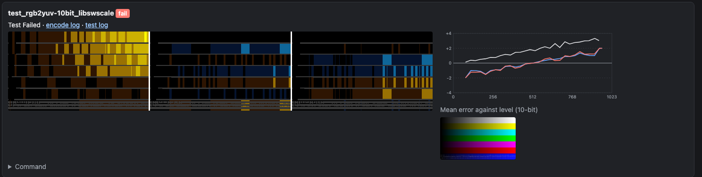
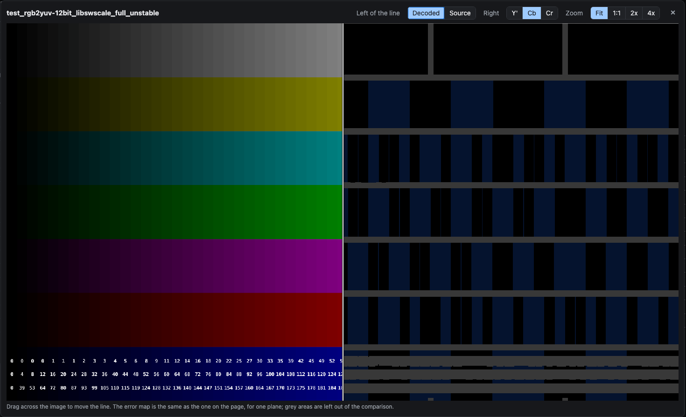
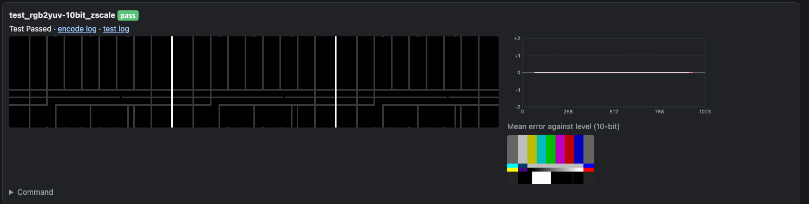
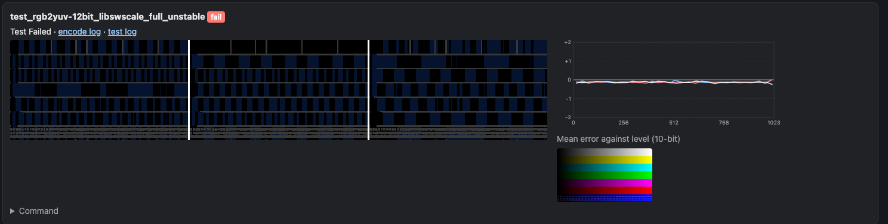
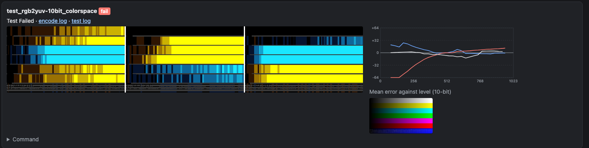
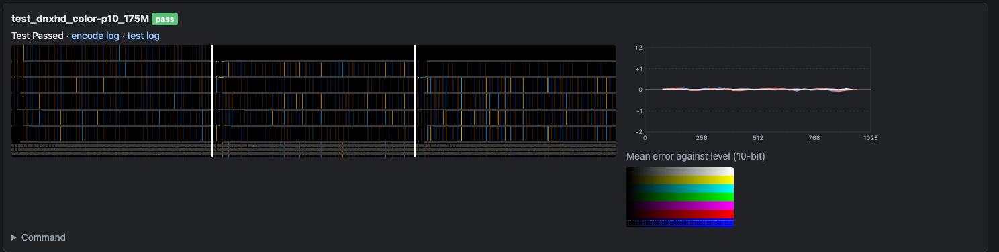
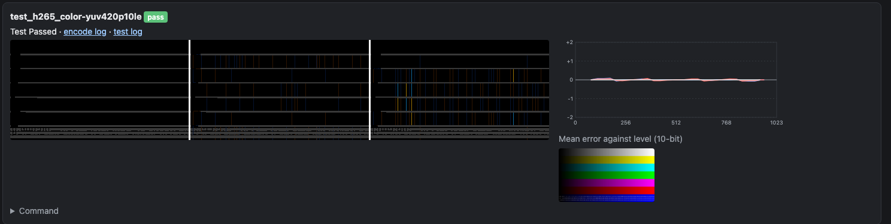

# Reading the Colour Test Reports

  

    Table of contents
  

  {: .text-delta }
1. TOC
{:toc}

The colour tests (`color_tests.yml`, the codec `*_color_tests.yml` configs and the documentation tests) use the
`ycbcr` comparison. Each encode is decoded at its own pixel format, so FFmpeg does no colour conversion, and
compared with the ideal conversion of the source image, done in numpy. The report (`ycbcr.html.jinja`) shows the
result for each wedge as a row of numbers, an error map and a plot. This page explains how to read them.

All errors are in **10-bit code values**, whatever the bit depth of the encode, so different bit depths compare
directly. One 8-bit code value is 4; one 12-bit code value is 0.25.

## The numbers

| Column | What it is | Use it for |
| :--- | :--- | :--- |
| White | The mean Y' error over the brightest areas, signed. Over &plusmn;1.5 is shown in red. | A white level (gain) error. Compression noise averages out, so this works for lossy codecs too. |
| Max | The largest error of any pixel, in the worst plane. | Lossless encodes, where anything over 1 (rounding) is a real error. For lossy codecs it is usually one pixel set by compression. |
| Mean | The mean error over all planes. | Small systematic errors, such as a rounding bias, that never exceed 1. |
| p99 | The 99th percentile error in the worst plane. | Lossy codecs: whether the image as a whole is off, rather than a few pixels. |
| Max per plane | Max for Y'/Cb/Cr (or G/B/R). | Which plane is wrong. |
| Range tag | The stream's range tag, tv (limited) or pc (full). | Checking the tag matches the pixels. |

All of these leave out the areas near edges (see [the grey areas](#the-grey-areas)).

## The error map

Each card has an error map: three panels, **Y' | Cb | Cr** from left to right, or **G | B | R** for RGB encodes.
Each panel is the whole frame, showing for each pixel how far the encode is from the ideal value:

* **Black**: exact.
* **Orange to yellow**: too high. **Blue to cyan**: too low.
* The colour brightens with the size of the error, to full at &plusmn;4 (set with `error_map_limit` in the
  comparison config).
* **Dim colour**: within rounding, meaning one code value of the encode, or one 10-bit code value for 12-bit and
  above. These errors are too small to matter on their own, but their pattern can still tell you something (see
  [a rounding bias](#a-rounding-bias)).
* **Grey**: left out of the comparison (see below).

The panels are drawn at half size. Each pixel of the map is a 2&times;2 block of the frame, showing the largest
error in that block with its sign, so single-pixel errors still show. For 4:2:2 and 4:2:0 encodes the chroma
panels are scaled up to the full frame, so the three panels line up.

### The grey areas

Grey marks the areas left out of every number on the report: anything within 8 pixels of an edge in the ideal
image. An edge is a step of more than 4 8-bit code values (16 at 10-bit) between neighbouring pixels, in any
plane.

These areas are left out because the result there depends on things other than the colour conversion:

* For 4:2:2 and 4:2:0, the chroma filter and chroma siting (see [Chroma Siting](../ChromaSiting.html)). Errors at
  the edges of coloured patches are expected, and different converters put them in different places.
* For lossy codecs, ringing at sharp edges.

Smooth gradients, such as the grey ramps, are not edges, so they are compared in full. On the chip chart about
18% of the frame is grey, as every chip has a border; on the SMPTE bars about 10%. The margin can be changed with
`margin` in the comparison config.

## The level plot

Beside each map is a plot of the **mean signed error against the ideal level**, one line per plane (white Y' or
G, blue Cb or B, red Cr or R). The level is in 10-bit code values: 64 to 940 for limited-range Y', with chroma
centred on 512. Each point is the mean over the pixels at that level, so noise averages out and a systematic error
stands out. The vertical scale fits the largest error, from &plusmn;2 up to &plusmn;64.

What the shapes mean:

* **Flat along 0**: no systematic error, even if the map shows noise.
* **Flat, away from 0**: an offset or bias, the same at every level.
* **A slope through 0**: a gain error. For Y' the error grows towards white; for Cb and Cr the lines cross 0 at
  512 and grow towards both ends, as the colours are too saturated or not saturated enough.
* **A curve**: the levels are being remapped, for example a transfer function or primaries conversion.
* **A line that stops early**: there are no pixels at those levels in the image.

Below the plot is a thumbnail of the decoded frame, converted to RGB in numpy rather than by FFmpeg.

## Comparing with the frame

Click an error map to open it over the frame (for reports from runs after this was added). The left of the line
shows the decoded frame, or the source; the right shows the error map for one plane, at the same position, so you
can see which patch an error is in. Drag across the image to move the line, and pick the plane and the zoom at the
top. Cmd- or Ctrl-click the map to open the image on its own instead.

Comparing the source with the decoded frame shows compression artefacts, but not colour errors of a few code
values, which are far too small to see. The error map is what shows those.

## Examples

All from FFmpeg 9.0.2.

### Exact

zscale converting the 10-bit SMPTE bars to 10-bit 4:4:4 limited range. Every number is 0, the panels are black
apart from the grey edges, and every line in the plot is flat on 0. This is what a correct lossless conversion
looks like.

### A white level error

libswscale (`scale=in_range=full:...:out_range=tv`) converting the 16-bit chip chart to 10-bit limited range.
White is +3.5 and max 4, so it fails. The Y' panel brightens towards the light chips, and its line in the plot
slopes up to about +3.5 at white: a luma gain error. The Cb and Cr lines cross 0 near 512 and slope from about
&minus;2 to +2: the chroma gain is too high as well. See
[the libswscale white level](../FFmpegChanges.html#libswscale-full-range-80) for which versions this affects.

### A rounding bias

libswscale with `flags=unstable`, converting the chip chart to 12-bit full range. The largest error is 1 12-bit
code value (0.25 in 10-bit), so every error is within rounding and drawn dim. But the errors are not random: about
half the chips are dim blue in all three planes, so they are 1 code value low, and none are high. The plot shows
it as a flat line at about &minus;0.12, close to 0 on the plot's &plusmn;2 scale. This looks like truncation
rather than rounding.

It is far too small to see, but it is a systematic bias rather than rounding noise, and it is why this wedge fails:
mean 0.117 against a limit of 0.1. Random rounding errors show as scattered dim speckle of both colours; whole
patches of one colour are a bias.

### The wrong conversion

The `colorspace` filter with `iall=bt601-6-625`, which treats the source as BT.601 625-line and converts its
primaries and transfer to BT.709 as well as the matrix. Max is 81 and p99 75. Most of the map is at full yellow or
cyan, as the errors are well past the &plusmn;4 limit, and the plot's scale has grown to &plusmn;64. The curves show
the levels being remapped. Errors this large are visible in the image.

### A lossy codec

DNxHD at 175 Mb/s, 10-bit 4:2:2. Max is 10, but p99 is 2, mean 0.2 and white 0, so it passes. The map is
scattered speckle of both colours, which is compression noise, and the plot is flat on 0: there is no systematic
colour error. For a lossy codec, judge it by p99, mean and white, and use the plot to check for a bias; the max is
set by a few pixels.

### 4:2:0

libx265 at 10-bit 4:2:0, converted with zscale. The Y' panel is black. The Cb and Cr panels have thin lines of
error at some chip edges: these are steps too small to count as edges (4 8-bit code values or less), so they are
not masked, and the 4:2:0 chroma filter softens them by up to half the step. That is where the max of 8 comes
from; p99 is 1 and the plot is flat. Larger steps are inside the grey areas.

## Other files

Each wedge also has, next to the report:

* `<test>.png`: the decoded frame as 16-bit RGB, converted in numpy.
* `<test>-errormap.png`: the error map as shown on the report, and `<test>-errormap-<plane>.png`, one plane each,
  for the viewer.
* `<source>-source.png`: the source, for the viewer.
* `<test>_tests.log`: the numbers in full, including per-plane max, mean and p99 in the encode's own code values,
  and `compared_fraction` (the fraction of the frame outside the grey areas).

The test options are described in the [test framework README](README.html).
